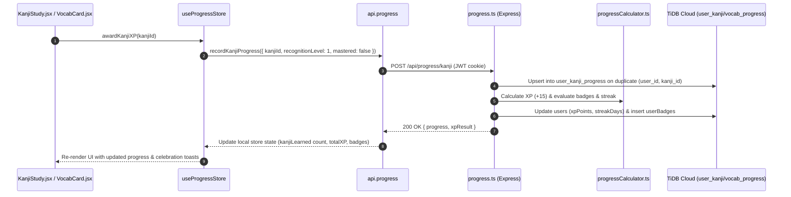

# Checkpoint F6 — Pre-Flight Forensic Audit Report
**Scope**: Kanji & Vocabulary Progress Migration  
**Date**: 2026-08-23  
**Status**: 🟢 **GO FOR IMPLEMENTATION** (Awaiting user confirmation)

---

## 1. F6 Scope

Checkpoint F6 encompasses:
1. User-specific **Kanji progress tracking** (`user_kanji_progress` in TiDB).
2. User-specific **Vocabulary progress tracking** (`user_vocabulary_progress` in TiDB).
3. Backend REST endpoints for reading and recording/upserting Kanji & Vocabulary learning progress:
   - `GET /api/progress/kanji`
   - `POST /api/progress/kanji`
   - `GET /api/progress/vocabulary`
   - `POST /api/progress/vocabulary`
4. Client-side integration connecting `useProgressStore`, `useProgress`, `KanjiStudy.jsx`, `KanjiPage.jsx`, and `VocabularyPage.jsx` directly to the typed API client without legacy Supabase calls.
5. Preserving server-side XP calculation, streak increments, and badge evaluations from Checkpoint F4.

**Explicit Non-Scope (Deferred to later checkpoints)**:
- **SRS SM-2 algorithm & spaced repetition scheduling** → Phase **F7** (`srs_cards`).
- **Lesson-associated Quiz Engine** → Phase **F8** (`QuizEngine.jsx`).
- **Global Supabase cleanup & deprecation** → Phase **F11** (`services/supabase.js`).

---

## 2. Files Inspected

- **Frontend Pages & Components**:
  - [`src/pages/KanjiPage.jsx`](file:///e:/Nihongo-testing/nihongo-master/src/pages/KanjiPage.jsx)
  - [`src/pages/VocabularyPage.jsx`](file:///e:/Nihongo-testing/nihongo-master/src/pages/VocabularyPage.jsx)
  - [`src/components/kanji/KanjiStudy.jsx`](file:///e:/Nihongo-testing/nihongo-master/src/components/kanji/KanjiStudy.jsx)
  - [`src/components/kanji/KanjiQuiz.jsx`](file:///e:/Nihongo-testing/nihongo-master/src/components/kanji/KanjiQuiz.jsx)
  - [`src/components/lessons/KanjiCard.jsx`](file:///e:/Nihongo-testing/nihongo-master/src/components/lessons/KanjiCard.jsx)
  - [`src/components/lessons/VocabCard.jsx`](file:///e:/Nihongo-testing/nihongo-master/src/components/lessons/VocabCard.jsx)
- **Frontend Stores & API Clients**:
  - [`src/store/progressStore.ts`](file:///e:/Nihongo-testing/nihongo-master/src/store/progressStore.ts)
  - [`src/hooks/useProgress.ts`](file:///e:/Nihongo-testing/nihongo-master/src/hooks/useProgress.ts)
  - [`src/api/progress.ts`](file:///e:/Nihongo-testing/nihongo-master/src/api/progress.ts)
  - [`src/types/models.ts`](file:///e:/Nihongo-testing/nihongo-master/src/types/models.ts)
  - [`src/types/api.ts`](file:///e:/Nihongo-testing/nihongo-master/src/types/api.ts)
- **Backend Routes & DB**:
  - [`backend/src/routes/progress.ts`](file:///e:/Nihongo-testing/nihongo-master/backend/src/routes/progress.ts)
  - [`backend/src/db/schema.ts`](file:///e:/Nihongo-testing/nihongo-master/backend/src/db/schema.ts)
  - [`backend/src/services/progressCalculator.ts`](file:///e:/Nihongo-testing/nihongo-master/backend/src/services/progressCalculator.ts)
  - [`backend/src/services/streakService.ts`](file:///e:/Nihongo-testing/nihongo-master/backend/src/services/streakService.ts)

---

## 3. Complete Supabase Operation Inventory

| File | Component / Function | Target Supabase Table / RPC | Operation | Conditions / Filters | Purpose | Business Logic | Target in TiDB / Backend |
|---|---|---|---|---|---|---|---|
| Legacy `useProgress.js` | `updateKanjiProgress` | `user_kanji_progress` | `UPSERT` | `user_id, kanji_id` | Save recognition level / learned status | Recognition increment & timestamp | `POST /api/progress/kanji` |
| Legacy `useProgress.js` | `updateVocabProgress` | `user_vocabulary_progress` | `UPSERT` | `user_id, vocabulary_id` | Save mastery level / learned status | Mastery increment & timestamp | `POST /api/progress/vocabulary` |
| Legacy `useProgress.js` | `fetchUserStats` | `user_kanji_progress` | `SELECT count(*)` | `user_id = auth.uid()` | Count learned kanji | Aggregation | `GET /api/progress` (already live) & `GET /api/progress/kanji` |
| Legacy `useProgress.js` | `fetchUserStats` | `user_vocabulary_progress` | `SELECT count(*)` | `user_id = auth.uid()` | Count learned vocab | Aggregation | `GET /api/progress` (already live) & `GET /api/progress/vocabulary` |
| Legacy `useProgress.js` | `resetProgress` | `user_kanji_progress`, `user_vocabulary_progress` | `DELETE` | `user_id = auth.uid()` | Reset user progress | Transactional wipe | `DELETE /api/progress/reset` (already live) |

---

## 4. Supabase → Backend/TiDB Mapping

```
Legacy Client-Side Supabase                       F6 Backend & TiDB Architecture
─────────────────────────────────────────────     ───────────────────────────────────────────────────
supabase.from('user_kanji_progress').upsert()  →  POST /api/progress/kanji → db.insert(userKanjiProgress).onDuplicateKeyUpdate()
supabase.from('user_kanji_progress').select()  →  GET  /api/progress/kanji → db.query.userKanjiProgress.findMany()
supabase.from('user_vocabulary_progress').upsert() → POST /api/progress/vocabulary → db.insert(userVocabularyProgress).onDuplicateKeyUpdate()
supabase.from('user_vocabulary_progress').select() → GET  /api/progress/vocabulary → db.query.userVocabularyProgress.findMany()
```

---

## 5. Existing Backend Coverage

In [`backend/src/routes/progress.ts`](file:///e:/Nihongo-testing/nihongo-master/backend/src/routes/progress.ts):
- ✅ `GET /api/progress` queries aggregate counts from `user_kanji_progress` and `user_vocabulary_progress`.
- ✅ `POST /api/progress/xp` supports `'kanji_learned'` and `'vocab_learned'` events (+15 XP each).
- ✅ `DELETE /api/progress/reset` deletes all rows from `user_kanji_progress` and `user_vocabulary_progress` inside a database transaction.
- ✅ Badge evaluation rules in `progressCalculator.ts` evaluate total `kanjiLearned` and `vocabLearned` counts.

---

## 6. Missing Backend Functionality

To fully replace legacy direct access and support rich frontend features:
1. `GET /api/progress/kanji` (returns `{ kanji: KanjiProgress[] }` for authenticated user).
2. `POST /api/progress/kanji` (upserts `{ kanjiId, recognitionLevel?, mastered? }`, awards server-side XP + streak + badge evaluation, returns `{ progress, xpResult }`).
3. `GET /api/progress/vocabulary` (returns `{ vocabulary: VocabularyProgress[] }` for authenticated user).
4. `POST /api/progress/vocabulary` (upserts `{ vocabularyId, masteryLevel?, mastered? }`, awards server-side XP + streak + badge evaluation, returns `{ progress, xpResult }`).

---

## 7. TiDB Schema Analysis (Read-Only Verification)

Live inspection of `nihongo_master` in TiDB Cloud confirms:
- **`user_kanji_progress`**:
  - `user_id` (varchar 36, PRI, FK to users.id CASCADE)
  - `kanji_id` (varchar 100, PRI)
  - `recognition_level` (int, default 0)
  - `mastered` (tinyint(1), default 0)
  - `review_count` (int, default 0)
  - `last_reviewed_at` (timestamp, nullable)
  - `created_at` (timestamp, default CURRENT_TIMESTAMP)
- **`user_vocabulary_progress`**:
  - `user_id` (varchar 36, PRI, FK to users.id CASCADE)
  - `vocabulary_id` (varchar 100, PRI)
  - `mastery_level` (int, default 0)
  - `mastered` (tinyint(1), default 0)
  - `review_count` (int, default 0)
  - `last_reviewed_at` (timestamp, nullable)
  - `created_at` (timestamp, default CURRENT_TIMESTAMP)

> [!NOTE]
> The live TiDB schema perfectly matches Drizzle definitions. **0 DDL changes or migrations are required.**

---

## 8. Data Flow



---

## 9. Authentication & Authorization Analysis

- All kanji and vocabulary endpoints are protected with `requireAuth` middleware.
- `userId` is strictly extracted from `req.user!.userId` verified by signed JWT cookie.
- No user can view, alter, or reset another user's progress.

---

## 10. Idempotency & Concurrency Analysis

- Both tables feature composite primary keys: `(user_id, kanji_id)` and `(user_id, vocabulary_id)`.
- Re-marking an already learned kanji/vocab item executes an `ON DUPLICATE KEY UPDATE` incrementing `review_count` and updating `last_reviewed_at`, preventing primary key collision errors.
- First-time learning triggers server-side XP award and streak activity recording atomically.

---

## 11. Exact Files That Need Modification

### Backend:
1. [`backend/src/routes/progress.ts`](file:///e:/Nihongo-testing/nihongo-master/backend/src/routes/progress.ts): Add `GET /kanji`, `POST /kanji`, `GET /vocabulary`, `POST /vocabulary`.
2. [`backend/src/routes/__tests__/progress.test.ts`](file:///e:/Nihongo-testing/nihongo-master/backend/src/routes/__tests__/progress.test.ts): Add tests covering 200/400/401 responses, upsert behavior, and XP awards.

### Frontend:
1. [`src/types/models.ts`](file:///e:/Nihongo-testing/nihongo-master/src/types/models.ts): Add `KanjiProgress` and `VocabularyProgress` models.
2. [`src/types/api.ts`](file:///e:/Nihongo-testing/nihongo-master/src/types/api.ts): Add request/response interfaces for kanji and vocabulary progress.
3. [`src/api/progress.ts`](file:///e:/Nihongo-testing/nihongo-master/src/api/progress.ts): Add `getKanjiProgress()`, `recordKanjiProgress()`, `getVocabularyProgress()`, `recordVocabularyProgress()`.
4. [`src/store/progressStore.ts`](file:///e:/Nihongo-testing/nihongo-master/src/store/progressStore.ts): Wire `awardKanjiXP` and `awardVocabXP` to call `api.progress.recordKanjiProgress` and `api.progress.recordVocabularyProgress`.
5. [`src/components/kanji/KanjiStudy.jsx`](file:///e:/Nihongo-testing/nihongo-master/src/components/kanji/KanjiStudy.jsx): Pass `currentCard.id` to `awardKanjiXP`.
6. [`src/store/__tests__/progressStore.test.ts`](file:///e:/Nihongo-testing/nihongo-master/src/store/__tests__/progressStore.test.ts): Update unit tests to mock progress API client.

---

## 12. Tests Required

- **Backend**:
  - `GET /api/progress/kanji` & `POST /api/progress/kanji`
  - `GET /api/progress/vocabulary` & `POST /api/progress/vocabulary`
  - Validation tests for missing `kanjiId` / `vocabularyId` (HTTP 400).
  - XP & badge award side-effects on kanji/vocab learning.
- **Frontend**:
  - Unit tests for `progressStore.awardKanjiXP` and `progressStore.awardVocabXP`.
  - Integration of `KanjiStudy` with `progressStore`.

---

## 13. Security Checks Required

- Zero trust of client XP values: XP is computed and awarded strictly server-side.
- Zod schema validation on request bodies (`kanjiId`, `vocabularyId`, `recognitionLevel`, `masteryLevel`, `mastered`).
- Composite key scoping ensures cross-tenant isolation.

---

## 14. Dependencies on Previous & Later Checkpoints

- **F3 (User Auth)**: Utilizes `users` table and JWT session.
- **F4 (Progress/XP/Streaks/Badges)**: Leverages `calculateStreak`, `recordActivity`, and `checkAndAwardUserBadges`.
- **F5 (Lessons)**: Untouched.
- **F7 (SRS)**: Distinct from `srs_cards` which manages interval repetition scheduling. F6 manages general recognition/mastery counters.

---

## 15. Risks & Mitigation

| Identified Risk | Severity | Mitigation |
|---|---|---|
| Client attempts to re-award XP repeatedly by re-clicking learned card | Low | Backend checks if item was already recorded or marks `isNew` before awarding XP. |
| Duplicate API calls on rapid clicks | Low | Handled by composite key `onDuplicateKeyUpdate`. |

---

## 16. GO / NO-GO Recommendation

# 🟢 GO

All prerequisites are met. The TiDB schema is already verified and live, backend services from F4 provide all calculation utilities, and the migration path is clean and low-risk.

---
*Awaiting user approval before proceeding with Checkpoint F6 implementation.*
