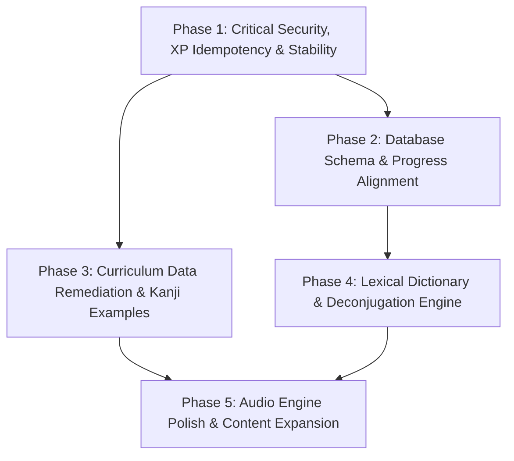

# Nihongo Master — Phased Implementation Roadmap

**Audit Date:** 2026-10-14  
**Auditor:** Antigravity System Audit  
**Repository:** `rohithram08/nihongo_master`  
**Current Git Branch:** `main` (Preserving uncommitted working tree changes)

---

## 1. Roadmap Architecture Overview

This roadmap translates the audit findings from [`BUG_AND_GAP_REGISTER.md`](file:///e:/Nihongo-testing/nihongo-master/docs/audit/BUG_AND_GAP_REGISTER.md) and [`CURRICULUM_DATA_AUDIT.md`](file:///e:/Nihongo-testing/nihongo-master/docs/audit/CURRICULUM_DATA_AUDIT.md) into a sequence of small, testable, and low-risk implementation phases.

---

## 2. Phase 1 — Critical Security, XP Idempotency & Stability (P0)

### 2.1 Scope & Targeted Fixes
- **BUG-001:** Enforce lesson completion idempotency in `backend/src/routes/progress.ts`. Query `user_lesson_progress` prior to awarding XP. If previously completed, award `0` XP and omit streak bonus.
- **BUG-002:** Add quiz score comparison and completion idempotency. Restrict repeated XP awards to improvements over personal best scores.
- **BUG-003:** Fix guest crash in `QuizEngine.jsx` by adding null safety (`user?.id`) and storing guest quiz scores in local state.
- **BUG-009:** Remove the unvalidated raw `amount` parameter from `POST /api/progress/xp`; restrict XP increments strictly to server-calculated activities.
- **BUG-004:** Separate kana learning from kanji by introducing a first-class `kana_learned` event.
- **BUG-005:** Decouple `+ SRS` bookmark button from instant XP rewards. XP must only be awarded upon active retrieval during review.
- **BUG-007:** Add optimistic state rollback in `progressStore.ts` if backend API requests fail.

### 2.2 Dependencies & Risks
- **Dependencies:** None. Self-contained to `backend/src/routes/progress.ts` and `src/store/progressStore.ts`.
- **Regression Risks:** Existing tests asserting optimistic XP updates or direct XP amounts may require updating to match the hardened contract.

### 2.3 Acceptance Criteria
1. Sending repeated `POST /api/progress/lesson` with the same `lessonId` awards XP only once.
2. Unauthenticated guests can complete quizzes without console errors or white-screens.
3. Sending `POST /api/progress/xp` with `{ amount: 1000 }` returns HTTP `400 Bad Request`.
4. Studying kana increments `kanaLearned` without altering `kanjiLearned` or triggering kanji badges.
5. All frontend and backend Vitest suites pass (`npm test` & `npm --prefix backend test`).

---

## 3. Phase 2 — Database Schema & Progress Architecture Alignment (P1)

### 3.1 Scope & Targeted Fixes
- **BUG-006:** Author migration `0004_grammar_and_kana_progress.sql` adding:
  - `user_grammar_progress` (`userId`, `patternId`, `status`, `mastered`, `timesStudied`, `lastStudiedAt`)
  - `user_kana_progress` (`userId`, `kanaId`, `strokeAccuracy`, `quizzedCount`, `mastered`)
  - `user_quiz_progress` (`userId`, `quizId`, `score`, `passed`, `attemptsCount`, `bestScore`)
- Create backend routes `GET/POST /api/progress/grammar` and `GET/POST /api/progress/kana`.
- **BUG-008:** Fix `cardsReviewed: 0` in `backend/src/routes/progress.ts:152`. Compute real review counts from `srs_cards` and `user_kanji_progress` / `user_vocabulary_progress` so `srs_100` and `srs_500` badges unlock properly.
- Update `src/pages/GrammarPage.jsx` to render interactive "Mark as Studied" toggles connected to `useProgressStore`.

### 3.2 Dependencies & Risks
- **Dependencies:** Phase 1 completed. TiDB database migration runner (`npm run db:migrate`).
- **Regression Risks:** Schema migrations must use `IF NOT EXISTS` guards and avoid locking existing tables.

### 3.3 Acceptance Criteria
1. Drizzle migration applies cleanly with zero data loss.
2. Marking a grammar pattern as studied persists across page reloads and browser restarts.
3. Users who reach 100 and 500 SRS reviews unlock "Review Rookie" and "Memory Builder" badges.

---

## 4. Phase 3 — Curriculum Data Remediation & Kanji Examples (P1)

### 4.1 Scope & Targeted Fixes
- **BUG-010:** Populate curated compound words, readings, and English translations for all 190 entries in `n4_kanji.js` and all 239 entries in `n3_kanji.js`.
- **BUG-011:** Deduplicate the 12 duplicate kanji characters across `n4_kanji.js` (`着`, `太`, `社`, `味`, `意`, `験`), `n3_kanji.js` (`論`, `表`, `際`, `産`, `仮`), and `n2_kanji.js` (`拡`).
- **BUG-012:** Link 3–5 thematic kanji characters into the `kanji: []` array for each of the 25 lessons across N5–N1.
- **BUG-018:** Standardize all curriculum data exports into typed TypeScript schemas with consistent property naming (`kanji`, `meaning`, `readings`, `examples`, `level`, `radical`).

### 4.2 Dependencies & Risks
- **Dependencies:** None. Static data refactoring.
- **Regression Risks:** Component tests asserting specific hardcoded counts (e.g. 940 kanji) must be updated to reflect clean deduplicated totals (928 unique kanji).

### 4.3 Acceptance Criteria
1. Every kanji card in `/kanji` displays at least 2 verified example compound words with furigana and English translations.
2. Automated dataset integrity tests assert zero duplicate kanji per level.
3. Every lesson in `/lessons` displays introduced kanji characters in its syllabus overview.

---

## 5. Phase 4 — Lexical Dictionary & Deconjugation Engine (P2)

### 5.1 Scope & Targeted Fixes
- **BUG-014:** Implement a production Japanese dictionary feature:
  - Create `src/utils/deconjugator.ts` to parse inflections (godan, ichidan, suru/kuru verbs, i/na adjectives).
  - Bundle a curated, compressed 15,000-word Core JMdict dataset (N5–N1 + Common words) under Creative Commons CC BY-SA 3.0 license.
  - Add prominent EDRDG copyright and attribution notice in settings and dictionary footer.
  - Create `/dictionary` page featuring instantaneous search across Kanji, Kana, Romaji, and English.
  - Integrate Pitch Accent contours from `pitchData.js` and audio pronunciation.
  - Add a one-tap `+ Add to SRS` button on every dictionary entry.

### 5.2 Dependencies & Risks
- **Dependencies:** Phases 1 and 2 (for safe SRS card enqueuing and data persistence).
- **Regression Risks:** Bundle size expansion. Mitigate by lazy-loading dictionary data chunks using dynamic `import()`.

### 5.3 Acceptance Criteria
1. Searching inflected forms like 食べた (*tabeta*) or 飲まない (*nomanai*) resolves to 食べる and 飲む.
2. Searching in English or Romaji returns correct Japanese headwords with pitch accent contour and audio.
3. Clicking `+ Add to SRS` enqueues the word into the user's active SRS deck.
4. EDRDG legal attribution is present and accessible in the UI.

---

## 6. Phase 5 — Audio Engine Polish & Curriculum Expansion (P3)

### 6.1 Scope & Targeted Fixes
- **BUG-015:** Refactor `useStoryAudio.ts` and `audioService.js` to eliminate race conditions on rapid sentence clicking by enforcing synchronous speech synthesis cancellation.
- **BUG-013:** Expand core vocabulary datasets from 176 words to standard benchmarks (800+ for N5, 1,500+ for N4).
- Expand N4 and N3 grammar from 15 to 60+ patterns each.
- **BUG-017:** Bundle KanjiVG stroke order vector data for all N4–N1 kanji characters.

### 6.2 Dependencies & Risks
- **Dependencies:** Phases 2, 3, and 4.
- **Regression Risks:** Audio service tests in jsdom require proper mock updates for `SpeechSynthesisUtterance`.

### 6.3 Acceptance Criteria
1. Rapid clicking across sentences in Graded Readers never results in overlapping audio speech.
2. Total vocabulary in the app exceeds 2,500 entries across N5–N3.
3. Stroke order animations render correctly for N4, N3, and N2 kanji.
