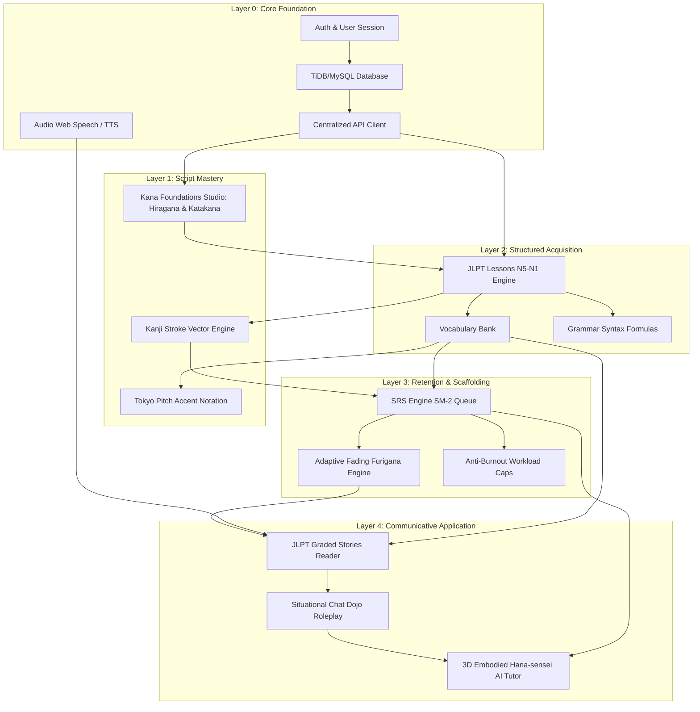

# Nihongo Master — Architectural State Audit & Implementation Roadmap

**Document Version:** 1.0.0  
**Date:** October 11, 2026  
**Status:** Approved Architectural Blueprint  

---

## 1. Verified Current-State Architecture Audit

### 1.1 Technology Stack & Infrastructure

```
┌────────────────────────────────────────────────────────────────────────┐
│                        FRONTEND CLIENT (SPA)                           │
│  React 18.3 • Vite 5.4 • React Router 6 • Tailwind CSS • Framer Motion │
│  Three.js / React Three Fiber (Hana-sensei 3D) • Zustand (State)       │
└───────────────────────────────────┬────────────────────────────────────┘
                                    │ HTTP / Cookie Session (Axios)
                                    ▼
┌────────────────────────────────────────────────────────────────────────┐
│                        BACKEND API (REST)                              │
│  Node.js • Express 4.19 • TypeScript (tsc) • Helmet • Express-Rate-Limit│
│  JWT Authentication (httpOnly Cookies) • Zod Validation                │
└───────────────────┬────────────────────────────────┬───────────────────┘
                    │ Drizzle ORM (mysql2)           │ Groq API
                    ▼                                ▼
┌───────────────────────────────────────┐ ┌──────────────────────────────┐
│          DATABASE (TiDB / MySQL)      │ │          AI SERVICES         │
│  8 Core Tables • Foreign Keys         │ │  Multi-Model Fallback Engine │
│  Indexes on Due Dates & User Progress │ │  RAG Platform Knowledge      │
└───────────────────────────────────────┘ └──────────────────────────────┘
```

#### Client Layer (`src/`)
- **Framework**: React 18 with Vite bundling (`vite.config.js`).
- **Styling**: Tailwind CSS with custom design tokens (`TINTS`, high-contrast dark/light mode palette).
- **State Management**: Zustand stores with localized slices (`authStore`, `progressStore`, `lessonStore`, `senseiStore`, `dailyGoalsStore`, `notificationStore`, `settingsStore`, `themeStore`).
- **3D Graphics**: Three.js + React Three Fiber rendering the 15.47 MB `hana-sensei.glb` character with 14 skeletal animations, 76 facial shape keys, and DOM spatial pointing.
- **Client Tests**: Vitest test runner (35 passed across 5 test suites).

#### Server Layer (`backend/`)
- **Runtime**: Node.js with Express and native TypeScript (`tsconfig.json`).
- **Security**: `helmet` headers, CORS origins whitelist, cookie parser, route rate limiting (`generalLimiter`, `aiLimiter`), input validation via Zod schemas.
- **Authentication**: JWT access tokens stored in `httpOnly` cookies, password hashing with `bcryptjs`.
- **Server Tests**: Vitest test runner (42 passed across 6 test suites).

#### Database Layer (`backend/src/db/`)
- **Engine**: TiDB / MySQL with SSL support.
- **ORM**: Drizzle ORM (`drizzle-orm/mysql2`) with typed schema definitions (`schema.ts`).
- **Tables (9 Total)**:
  1. `users` (UUID primary key, credentials, level, XP, streak, avatar).
  2. `user_lesson_progress` (composite key: `user_id` + `lesson_id`, completion status, score).
  3. `user_kanji_progress` (composite key: `user_id` + `kanji_id`, recognition level, mastery boolean).
  4. `user_vocabulary_progress` (composite key: `user_id` + `vocabulary_id`, mastery level).
  5. `user_streaks` (composite key: `user_id` + `date`, daily XP, minutes studied).
  6. `user_badges` (user achievements with unique constraint on `user_id` + `badge_type`).
  7. `srs_cards` (SM-2 spaced repetition cards with composite indexes on `next_review_date` and `is_mastered`).
  8. `sensei_conversations` (chat history with sentiment and emotion tags).
  9. `sensei_tour_progress` (9-step onboarding walkthrough state).

---

### 1.2 Data Flow & Decoupling Reality Check

Our code-level audit revealed that while backend APIs and DB tables exist for the entire learning journey, **several critical frontend features are decoupled from the backend**:

| Learning Action | Intended Destination | Current Actual Data Flow | Severity |
| :--- | :--- | :--- | :--- |
| **Completing a Lesson** | `user_lesson_progress` table | ✅ **Fully Wired**: Calls `apiCompleteLesson`, updates database, calculates XP, awards streak & badges. | None (Working) |
| **Reviewing Due SRS Cards** | `srs_cards` table | ✅ **Fully Wired**: Fetches via `/api/srs/due`, updates SM-2 ease factor & interval via `/api/srs/cards/:id/review`. | None (Working) |
| **Adding Cards to SRS** | `srs_cards` table | ❌ **Completely Disconnected**: `addCard` endpoint and `useSRS` hook exist, but are **never invoked** when studying lessons, kanji, or vocabulary. | **CRITICAL** |
| **Practicing Kanji Flashcards** | `user_kanji_progress` table | ⚠️ **Client-Only State**: `KanjiPage.jsx` flashcards mode tracks known/missed in local React state, never syncing to DB or granting XP. | **HIGH** |
| **Studying Vocabulary** | `user_vocabulary_progress` table | ⚠️ **Read-Only**: `VocabularyPage.jsx` displays static data; has no "Mark as learned" or "Add to SRS" triggers. | **HIGH** |
| **Inspecting Peer Profiles** | `users` table via API | ❌ **Mock Dictionary**: `UserProfilePage.jsx` reads from a hardcoded `ALL_USERS` dictionary; no `GET /api/users/:userId` endpoint exists. | **MEDIUM** |
| **AI Conversational Practice** | Unified AI Service | ⚠️ **Architectural Duality**: `SenseiPage.tsx` uses multi-model fallback, RAG, and guardrails via `/api/sensei`; `ChatInterface` and `ChatDojo` call a raw Groq proxy via `/api/ai`. | **HIGH** |

---

## 2. Existing-Feature Inventory with Implementation Status

| Feature / Module | Route | Implementation Status | Functional Audit Notes |
| :--- | :--- | :--- | :--- |
| **Authentication** | `/login`, `/register` | **Fully Functional** | Secure JWT in httpOnly cookie, password bcrypting, Zod validation, profile sync. |
| **Dashboard** | `/dashboard` | **Fully Functional** | Real-time XP, streak, due SRS cards badge, quick resume actions. |
| **Structured Lessons** | `/lessons`, `/lessons/:level/:day` | **Fully Functional** | N5–N1 curricula, multi-section viewer, dialogues, culture notes, backend XP sync. |
| **Kanji Studio** | `/kanji` | **Partially Functional** | 5 study modes work visually, but flashcards and writing canvas do not persist mastery to DB. |
| **Vocabulary Bank** | `/vocabulary` | **Partially Functional** | Rich multi-language translations (EN, TA, HI), but lacks study modes or SRS add buttons. |
| **Grammar Guide** | `/grammar` | **Partially Functional** | Excellent monospace formation syntax and nuance notes, but purely passive reference. |
| **Quiz Engine** | `/quiz`, `/quiz/:lessonId` | **Fully Functional** | Multiple choice, fill-in-blank, timer, confetti, dynamic question generation. |
| **SRS Review Queue** | `/review` | **Fully Functional** | SM-2 algorithm, 4 quality buttons (0, 2, 4, 5), interval modes, but queue lacks card intake. |
| **Hana-sensei 3D Studio** | `/sensei` | **Fully Functional** | 3D WebGL GLB, 14 animations, 11 facial emotions, DOM pointing, 9-step guided tour. |
| **Chat Dojo (Roleplay)** | `/chat-dojo` | **Partially Functional** | 6 situational roleplays with hints and vocabulary extraction, but uses raw Groq proxy instead of Sensei engine. |
| **Free Chat Interface** | `/chat` | **Redundant** | Overlaps with Chat Dojo and Sensei Studio; uses legacy non-RAG backend. |
| **Speech Practice** | `/speech` | **Partially Functional** | Web Speech STT with Levenshtein scoring; lacks pitch accent verification. |
| **Drama Theater** | `/drama` | **Partially Functional** | Curated immersion video/podcast catalog; lacks in-app synchronized transcripts. |
| **Progress & Radar** | `/progress` | **Fully Functional** | 6-axis skill breakdown, weekly study charts, JLPT ladder, XP history. |
| **Achievements** | `/achievements` | **Fully Functional** | 50+ badges across 5 tiers, secret achievements, dynamic progress evaluation. |
| **User Profile** | `/profile` | **Fully Functional** | Avatar picker (15 Japanese presets + upload), XP ranks, JLPT goals. |
| **Peer Profile** | `/profile/:userId` | **Mocked** | Uses hardcoded mock dictionary `ALL_USERS`. |
| **Settings** | `/settings` | **Fully Functional** | Furigana/Romaji toggles, theme switching, SRS interval tuning, data export. |
| **Kana Foundations** | *None* | **Missing** | **No dedicated Hiragana/Katakana study module exists for zero-beginners.** |
| **Graded Readers** | *None* | **Missing** | No long-form extensive reading engine with click-to-lookup dictionary. |

---

## 3. Prioritized List of Functional Gaps & Technical Risks

### High-Priority Functional Gaps
1. **Missing Kana Foundations (Zero-Beginner Onboarding)**:
   - *Impact*: Learners entering without Hiragana/Katakana knowledge are dropped directly into N5 kanji/grammar and immediately churn.
   - *Fix*: Build a dedicated "Kana Studio" (sound grid, stroke order tracing, audio pairing).
2. **Disconnected SRS Intake Flow**:
   - *Impact*: The SRS deck never populates unless manually injected.
   - *Fix*: Add 1-click "Add to SRS" buttons on every vocabulary, kanji, and grammar card, plus automatic intake upon lesson completion.
3. **Decoupled Kanji & Vocabulary Mastery Persistence**:
   - *Impact*: Kanji canvas and vocabulary browsing do not write to `user_kanji_progress` or `user_vocabulary_progress`.
   - *Fix*: Call `recordKanjiProgress` and `recordVocabularyProgress` API handlers upon study session completion.
4. **Lack of Tokyo Pitch Accent ($F_0$) Data & Visualization**:
   - *Impact*: Speech practice validates word strings but ignores pitch drops, reinforcing flat foreign intonation.
   - *Fix*: Annotate vocabulary with Tokyo pitch accent codes (0: Heiban, 1: Atamadaka, etc.) and render visual pitch-height brackets.
5. **Static Furigana without Adaptive Fading**:
   - *Impact*: Induces the split-attention effect; learners stare at kana instead of recognizing kanji.
   - *Fix*: Implement an adaptive furigana engine that hides ruby text for kanji with $\ge 3$ successful SRS reviews.
6. **No Graded Reading / Extensive Reading Module**:
   - *Impact*: Learners cannot transition from single-word flashcards to authentic Japanese paragraphs.
   - *Fix*: Create a JLPT Graded Reader with synchronized audio and click-to-lookup definitions.

### Technical & Architectural Risks
1. **AI Endpoint Duality**:
   - `ai.ts` (raw Groq) and `sensei.ts` (SenseiService with RAG + guardrails) are disconnected. All conversational features should converge on the Sensei brain.
2. **Main Bundle Size (3.1 MB)**:
   - Vite produces a chunk warning on build. Needs dynamic `import()` code-splitting for Three.js, Canvas components, and heavy N1–N5 datasets.
3. **External AI API Outage Resilience**:
   - If Groq API experiences rate limiting or downtime, chat fails. Need graceful fallback to pre-cached offline drills and rule-based recasts.

---

## 4. Feature Dependency Map



---

## 5. Phased Implementation Roadmap with Acceptance Criteria

### Phase 1: Core Foundation & Data Wiring (Quick Wins)
- **Scope**:
  - Connect `useSRS` and add 1-click "Add to SRS" across Kanji, Vocabulary, and Lessons.
  - Wire `KanjiPage.jsx` flashcards and `VocabularyPage.jsx` to persist progress to DB.
  - Implement public `GET /api/users/:userId` endpoint and replace `ALL_USERS` mock in `UserProfilePage.jsx`.
  - Unify AI chat routes so `ChatDojo` leverages `senseiService` intelligence.
- **Acceptance Criteria**:
  - Clicking "Add to SRS" persists card to `srs_cards` and increments due queue.
  - User profile URLs (`/profile/:userId`) render live DB data for existing users.
  - 100% unit test pass rate with zero mock data in profile routing.

### Phase 2: Kana Foundations Studio (Beginner Onboarding)
- **Scope**:
  - Dedicated `/kana` page with Hiragana and Katakana 46-character grids.
  - Audio pronunciation playback for every mora.
  - Interactive SVG stroke-order tracing canvas.
  - Rapid recognition pairing game (Audio $\to$ Kana, Romaji $\to$ Kana).
- **Acceptance Criteria**:
  - Zero-knowledge beginners can complete Hiragana Day 1 within 5 minutes.
  - 100% stroke order accuracy check with visual feedback.

### Phase 3: Japanese Linguistic Accuracy & Pitch Accent
- **Scope**:
  - Tokyo pitch accent metadata (Heiban, Atamadaka, Nakadaka, Odaka) added to vocabulary entries.
  - Visual high/low contour brackets rendered on vocabulary cards and lesson words.
  - Adaptive Fading Furigana: dynamically suppress ruby text for words mastered at SRS Level $\ge 3$.
- **Acceptance Criteria**:
  - Pitch accent contours render accurately with no layout shifts.
  - Mastered kanji display cleanly without furigana; clicking toggles ruby text on demand.

### Phase 4: Contextual Immersion & Graded Stories
- **Scope**:
  - Dedicated `/stories` JLPT Graded Reading theater.
  - Sentence-by-sentence dual-script reading with synchronized audio.
  - Click-to-lookup dictionary modal with 1-click "Add Word to SRS".
  - Comprehension check questions at the end of each story.
- **Acceptance Criteria**:
  - Learners can read an N5-level story and immediately save unknown vocabulary to their active SRS deck.

### Phase 5: Anti-Burnout Gamification & Habit Loop
- **Scope**:
  - SRS session batching (configurable 15, 25, or 35 cards max per batch).
  - "Catch-Up Mode" for returning learners to prevent backlog dread.
  - Streak freeze shields and grace periods.
  - Replace raw XP leaderboards with collaborative milestone achievements.
- **Acceptance Criteria**:
  - No user faces an unmanageable $>100$ card backlog upon returning after a break.

### Phase 6: Hana-sensei Evolution & ZPD Hinting
- **Scope**:
  - Enhance `senseiPrompts.ts` with explicit 4-tier graduated hinting (recasts instead of answers).
  - Floating Hana-sensei companion toggle available across Lessons and Stories.
  - Contextual dialogue injection: due SRS words are organically used by Hana in chat practice.
- **Acceptance Criteria**:
  - When a user asks for an answer, Hana offers an implicit recast or hint first in $\ge 90\%$ of test turns.

---

## 6. Testing and Validation Strategy

1. **Automated Unit & Integration Testing**:
   - Run Vitest suites for both frontend (`src/**/__tests__`) and backend (`backend/src/**/__tests__`) on every change.
   - Require 100% passing tests before merging any phase.
2. **Data Flow Validation Checks**:
   - Inspect network payloads and database tables (`db.select()`) to verify persistence of every new learning action.
3. **End-to-End (E2E) Browser Verification**:
   - Test critical learner paths (Registration $\to$ Lesson 1 $\to$ Add to SRS $\to$ Review Queue $\to$ Chat Dojo) in headless Chrome.
4. **Performance & Memory Profiling**:
   - Enforce performance budgets: maintain 60 FPS in WebGL stage, $<200$ MB JS heap, $<2$s cold page load.

---

## 7. Recommended Implementation Order & AI Model Advisory

| Step | Task Name | Expected Impact | Complexity | Risk | Recommended Model | Rationale |
| :---: | :--- | :---: | :---: | :---: | :--- | :--- |
| **1** | **SRS Intake & Progress Wiring** | **CRITICAL** | Low | Low | **Gemini 3.8 Flash** | Fast, high-accuracy codebase wiring; connects existing backend endpoints to UI buttons. |
| **2** | **Peer Profile DB Endpoint** | Medium | Low | Low | **Gemini 3.8 Flash** | Straightforward endpoint creation and mock replacement. |
| **3** | **Kana Foundations Studio** | **HIGH** | Medium | Low | **Claude Opus 4.6 (Thinking)** | Requires careful educational UX design, SVG stroke paths, and audio pairing. |
| **4** | **Adaptive Fading Furigana** | **HIGH** | Medium | Medium | **Claude Opus 4.6 (Thinking)** | Deep state integration across `progressStore`, text parsers, and card components. |
| **5** | **Tokyo Pitch Accent Visualizer** | **HIGH** | Medium | Low | **Gemini 3.8 Flash** | Dataset enrichment and CSS contour bracket component rendering. |
| **6** | **JLPT Graded Reader Engine** | **HIGH** | High | Medium | **Claude Opus 4.6 (Thinking)** | Complex interactive reading component with audio-sync and dictionary lookup. |
| **7** | **Anti-Burnout SRS Pacing** | Medium | Medium | Low | **Gemini 3.8 Flash** | Algorithm adjustment and batching controls in `SRSReview.jsx`. |
| **8** | **ZPD Hinting in Sensei AI** | **HIGH** | Medium | Low | **Claude Opus 4.6 (Thinking)** | Complex prompt engineering, few-shot recasts, and tool-call tuning. |
