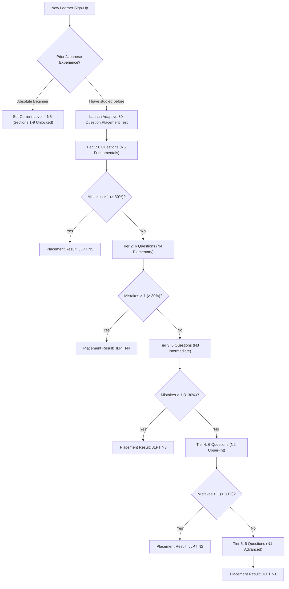

# Nihongo Master — Curriculum Roadmap, Placement & Progression Design

**Document Version:** 1.0.0  
**Status:** Pedagogical & Architectural Baseline  
**Date:** 2026-10-14  
**Author:** Antigravity Curriculum & Learning Science Core  

---

## 1. Executive Summary & Curriculum Scope

The existing Nihongo Master curriculum contains 25 lessons (5 per JLPT level), isolated from kanji orthography (`kanji: []` across all lessons), with 176 total vocabulary words and 130 grammar patterns. 

To deliver comprehensive Japanese acquisition, this design establishes a **45–54 lesson structured progression per JLPT level** across 9 progressive thematic sections, totaling **225–270 lessons across N5 to N1**.

Each lesson functions as a cohesive learning unit that unifies dialogue, contextual vocabulary, kanji orthography, grammar mechanics, audio pronunciation, and comprehension assessment. Furthermore, this specification defines the **Placement Diagnostic Engine**, **Level Visibility Gating**, and the **Peer-Review Content Workflow**.

---

## 2. 9-Section Curriculum Architecture (N5–N1)

Every JLPT level is partitioned into 9 sequential sections. Each section comprises 5–6 atomic lessons followed by a Section Milestone Exam.

```
LEVEL PROGRESSION (e.g., JLPT N5)
┌──────────────┐   ┌──────────────┐   ┌──────────────┐          ┌──────────────┐
│  Section 1   │──>│  Section 2   │──>│  Section 3   │── ... ──>│  Section 9   │
│ (Lessons 1-5)│   │ (Lessons 6-11│   │(Lessons 12-16│          │(Lessons 43-48│
└──────┬───────┘   └──────────────┘   └──────────────┘          └──────┬───────┘
       │                                                               │
       ▼                                                               ▼
[Section 1 Milestone Exam]                                   [N5 Cumulative Final Exam]
(Unlocks Section 2)                                          (Unlocks JLPT N4 Level)
```

### 2.1 Section Breakdown by JLPT Level

#### JLPT N5: Beginner Foundations (48 Lessons Total)
1. **Section 1: First Encounters & Daily Greetings** (Lessons 1–5): Pronouns, introductions, `〜は〜です`, numbers 1–10. Kanji: 一, 二, 三, 人, 日.
2. **Section 2: People, Family & Identity** (Lessons 6–10): Family terms, occupations, nationality, `〜の`, `〜も`. Kanji: 本, 月, 年, 父, 母.
3. **Section 3: Time, Dates & Daily Routine** (Lessons 11–16): Days of the week, hours/minutes, particle `に`, basic verbs (起きる, 寝る). Kanji: 時, 分, 今, 朝, 昼, 晩.
4. **Section 4: Space, Objects & Locations** (Lessons 17–21): Demonstratives (`これ・それ・あれ`), `〜にあります・います`. Kanji: 上, 下, 中, 前, 後.
5. **Section 5: Daily Movement & Transportation** (Lessons 22–27): Direction particle `へ/に`, means particle `で`, verbs (行く, 来る, 帰る). Kanji: 行, 来, 車, 駅, 校.
6. **Section 6: Food, Dining & Daily Purchases** (Lessons 28–33): Object particle `を`, counters (`つ, 本, 枚`), restaurant dialogues. Kanji: 食, 飲, 買, 店, 魚.
7. **Section 7: Describing the World (Adjectives)** (Lessons 34–38): い-adjectives, な-adjectives, present & past conjugations. Kanji: 大, 小, 高, 白, 新.
8. **Section 8: Activities, Hobbies & Invitations** (Lessons 39–43): `〜ませんか`, `〜ましょう`, expressing desires `〜たい`. Kanji: 見, 聞, 書, 読, 友.
9. **Section 9: Connecting Actions & Giving Directions** (Lessons 44–48): て-form introduction, `〜てください`, progressive `〜ています`. Kanji: 手, 足, 道, 右, 左.

#### JLPT N4: Elementary Fluency (48 Lessons Total)
- **Section 10:** Polite Requests & Permissions (`〜てもいいですか`, `〜てはいけません`)
- **Section 11:** Sequences, Conjunctions & Reasons (`〜から`, `〜ので`, `〜てから`)
- **Section 12:** Experience & Past Recollection (`〜たことがある`, `〜たり〜たりする`)
- **Section 13:** Potential & Ability (`〜ができる`, Potential verb forms)
- **Section 14:** Comparisons, Preferences & Superlatives (`〜より〜のほうが`, `一番`)
- **Section 15:** Intentions & Future Plans (Volitional form, `〜つもり`, `〜予定`)
- **Section 16:** Advice, Obligation & Necessity (`〜たほうがいい`, `〜なければならない`)
- **Section 17:** Hearsay, Conjectures & Appearance (`〜そうだ`, `〜ようだ`, `〜らしい`)
- **Section 18:** Passive & Causative Foundations (`〜られる`, `〜させる`)

#### JLPT N3: Intermediate Transition (50 Lessons Total)
- **Sections 19–27:** Complex conditional structures (`〜たら`, `〜ば`, `〜なら`, `〜と`), honorifics & humble speech (*Keigo* & *Kenjougo*), transitive/intransitive verb pairings, formal discourse connectives, and multi-clause situational reading comprehension.

#### JLPT N2: Upper-Intermediate Competence (50 Lessons Total)
- **Sections 28–36:** Abstract reasoning, news reports, essay syntax (`〜にわたって`, `〜を通じて`, `〜ざるを得ない`), business communication, idiomatic expressions, and nuance differentiation between near-synonyms.

#### JLPT N1: Advanced Fluency & Register Mastery (50 Lessons Total)
- **Sections 37–45:** Classical grammatical remnants, literary expressions, editorial debates, legal/administrative registers, and high-frequency colloquial slurs and dialectal variations.

---

## 3. The 10-Component Lesson Anatomy

To ensure consistent pedagogical rigor, every single lesson across N5–N1 conforms to the **10-Component Lesson Specification**:

```
┌────────────────────────────────────────────────────────────────────────┐
│                   ATOMIC LESSON ARCHITECTURE (10 PARTS)                │
├────────────────────────────────┬───────────────────────────────────────┤
│ 1. Opening Micro-Dialogue      │ Realistic situational context (audio) │
│ 2. Contextual Vocabulary (3–6) │ Words introduced naturally in dialogue│
│ 3. Core Grammar Point (1–2)    │ Structural rules, formation, pitfalls │
│ 4. Integrated Kanji (2–4)      │ Characters taught alongside vocab     │
│ 5. Pitch & Audio Pronunciation │ Native recordings + Pitch contour SVG │
│ 6. 3–5 Curated Examples/Entry  │ Rich, natural Japanese sentences      │
│ 7. Interactive Practice Checks │ 4–6 quick inline verification checks  │
│ 8. Lesson Exit Quiz            │ 5-question graded evaluation          │
│ 9. Server Progress Checkpoint  │ Idempotent XP grant & milestone sync  │
│ 10. Automated SRS Enqueue      │ Seamless transition to memory review  │
└────────────────────────────────┴───────────────────────────────────────┘
```

### Detailed Component Specifications:
1. **Opening Micro-Dialogue / Story Excerpt:** 3–6 conversational turns between characters situated in a culturally authentic setting (e.g., station kiosk, university office, cafe).
2. **Vocabulary in Context:** 3–6 headwords explicitly derived from the dialogue. No isolated, uncontextualized word lists.
3. **Grammar Blueprint:** Structural formation formula (e.g., `[Verb て-form] + ください`), register usage notes, and common learner traps.
4. **Kanji in Context:** 2–4 kanji characters that form the introduced vocabulary, complete with stroke count, radical, on/kun readings, and animated stroke sequence.
5. **Pitch Accent & Audio:** Authentic audio asset references and visual Tokyo pitch accent contour representations.
6. **Curated Examples:** Minimum of 3 and maximum of 5 verified example sentences for every vocabulary, kanji, and grammar entry, featuring furigana and localized glosses.
7. **Interactive Practice Checks:** Active recall checks inside the lesson (sentence builder, audio tap, cloze selection).
8. **Lesson Exit Quiz:** A 5-question adaptive quiz verifying retention of the lesson's target components.
9. **Server Progress Checkpoint:** Authoritative dispatch updating `user_lesson_progress` and awarding XP.
10. **SRS Seed Queue:** Tapping "Finish" automatically prompts the user to add the lesson's new kanji and vocabulary to their SRS deck.

---

## 4. Placement Test & Level Gating Engine

To prevent intermediate learners from grinding through beginner kana lessons while protecting beginners from overwhelming advanced content, Nihongo Master implements **Diagnostic Placement** and **Strict Server-Gated Level Visibility**.

### 4.1 Onboarding & Diagnostic Placement Test



### 4.2 Placement Passing Criteria (<= 30% Incorrect Rule)
- **Structure:** 30 questions total (6 questions per JLPT tier from N5 to N1).
- **Passing Threshold:** Maximum of 30% incorrect answers per tier (equivalent to **>= 70% accuracy**, or at least 5 out of 6 correct per tier).
- **Early Termination:** If a student scores below 70% in any tier, the test terminates immediately to avoid testing fatigue, placing the user in that tier.
- **Retry Policy:** Users can retake the placement test after a **14-day cooldown period** to prevent random guessing exploits.
- **Server Authority:** The client submits raw answers to `POST /api/progress/placement`. The backend evaluates answers against hash-sealed answer keys, calculates the placement level, issues a tamper-proof JWT claim, and writes `users.currentLevel` in the database.

### 4.3 Level Visibility & Gating Rules
The frontend interface dynamically adapts based on the user's unlocked tier:

| User Level | Lessons Visible & Playable | Higher Levels (N4–N1) | Review Access |
| :--- | :--- | :--- | :--- |
| **N5** | All 48 N5 Lessons | Locked (Padlock icon + "Complete N5 Final to Unlock") | Unlimited N5 review |
| **N4** | N5 + All 48 N4 Lessons | N3–N1 Locked | Full N5 + N4 review |
| **N3** | N5 + N4 + All 50 N3 Lessons | N2–N1 Locked | Full N5–N3 review |
| **N2** | N5–N2 Lessons | N1 Locked | Full N5–N2 review |
| **N1** | Full Catalog (All 240+ Lessons) | None locked | Full catalog access |

> [!IMPORTANT]
> **API Security Enforcement:** Backend route middleware (`verifyLevelAccess`) rejects any direct HTTP requests to lesson endpoints above the user's unlocked tier with `403 Forbidden` (`INSUFFICIENT_LEVEL_CLEARANCE`).

---

## 5. Standalone Pages vs. Structured Lessons

A recurring architectural defect in the current app is the disconnection between standalone pages (`/kanji`, `/vocabulary`, `/grammar`) and the core lesson path (`/lessons`).

### Unified Data Flow Integration:
1. **Lessons as the Primary Ingestion Vector:** Learners first encounter words, kanji, and grammar in cohesive, narrative lesson environments.
2. **Standalone Pages as Reference Libraries:** 
   - `/kanji`, `/vocabulary`, and `/grammar` serve as searchable, filterable reference compendiums.
   - Every card on a standalone page displays a badge linking back to its introducing lesson: e.g., *"Introduced in N5 Section 2, Lesson 8"*.
   - Marking a kanji or grammar point as studied in a standalone page updates the exact same `user_kanji_progress` / `user_grammar_progress` record as completing it in a lesson.
3. **SRS as the Retention Loop:** Adding an item to SRS from a lesson, a graded story, or a standalone dictionary card feeds into the single central `srs_cards` table.

---

## 6. Content Review & Peer-Audit Protocol

To prevent the generation of unverified, hallucinated, or unnatural Japanese entries, all newly authored curriculum content must pass a 4-stage quality gate before ingestion into `src/data/canonical/`:

```
┌────────────────────────────────────────────────────────────────────────┐
│                      CONTENT QUALITY VERIFICATION GATE                 │
├────────────────────┬────────────────────┬──────────────────────────────┤
│ 1. Schema          │ 2. Native Linguistic│ 3. Audio & Pitch             │
│    Validation      │    Review          │    Verification              │
│    JSON Schema     │    Natural register│    NHK Accent alignment;     │
│    compliance test │    & JLPT accuracy │    clean audio tags.         │
├────────────────────┴────────────────────┴──────────────────────────────┤
│ 4. Attribution & Licensing Documentation                               │
│    Verification of source provenance (EDRDG, Tatoeba, or original)      │
└────────────────────────────────────────────────────────────────────────┘
```

1. **Schema Automated Gate:** TypeScript compiler and Zod schema validation assert that all required properties (`headword`, `reading`, `furigana`, `examples >= 3`) are strictly populated.
2. **Native Linguistic Peer Review:** All example sentences and dialogues must be reviewed by a certified Japanese language instructor for natural phrasing, correct pitch-accent register, and JLPT-level appropriateness.
3. **Acoustic & Accent Alignment:** Verifying that pitch drops match Tokyo standard pronunciation and audio files are free from distortion or synthetic clipping.
4. **Source Attribution Log:** Recording the author, reviewer, date, and license of all imported linguistic assets in `docs/curriculum/ATTRIBUTION_LOG.md`.
