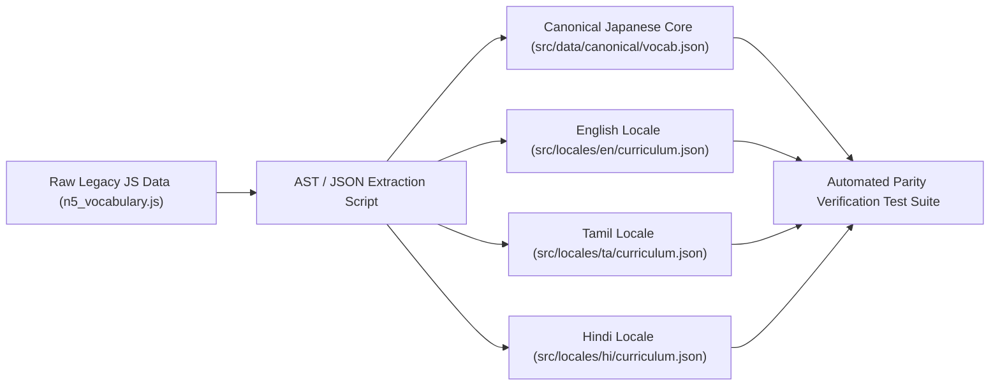
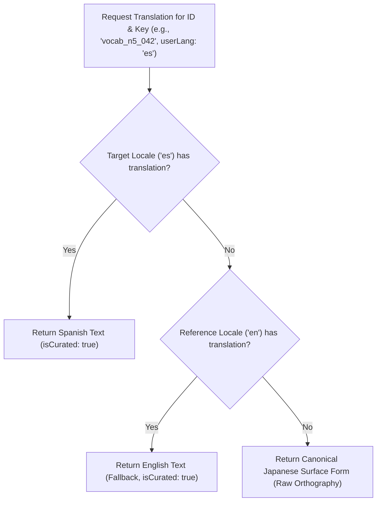

# Nihongo Master — Multilingual Data & Localization Architecture

**Document Version:** 1.0.0  
**Status:** Architecture Specification Baseline  
**Date:** 2026-10-14  
**Author:** Antigravity Architecture Core  

---

## 1. Executive Summary & Problem Statement

Nihongo Master was envisioned with multilingual support, notably featuring human-written English, Tamil, and Hindi translations for introductory N5 vocabulary and kanji. However, the current implementation is architecturally tangled:
1. **Linguistic Coupling:** Curated Tamil (`ta`) and Hindi (`hi`) translations are hardcoded directly as ad-hoc property keys inside raw JavaScript data files (`n5_vocabulary.js` and `n5_kanji.js`).
2. **Curriculum Fragmentation:** Advanced levels (N4, N3, N2, N1) dropped multilingual fields completely, defaulting to English-only string properties (`meaning: "..."`).
3. **Monolingual Application Shell:** The user interface (navigation labels, button texts, modal instructions, error alerts, settings headers) is 100% hardcoded in English across all React components. Selecting "Spanish" or "Tamil" on the language picker changes only word definitions in lessons, creating an awkward, half-localized user experience.
4. **Third-Party API Privacy & Rate-Limit Risks:** For uncurated languages, `translationService.js` dispatches live HTTP queries directly from the user's browser to MyMemory (`api.mymemory.translated.net`), creating network latency, UI flashing, rate limits, and potential privacy leaks.

This document defines a clean, scalable **Three-Tier Multilingual Architecture** that decouples canonical Japanese source content from localized glosses and user preferences, preserves all existing Tamil and Hindi human translations, and supports arbitrary new languages via standard i18n tooling without modifying Japanese curriculum source files.

---

## 2. The Three-Tier Separation Model

```
┌────────────────────────────────────────────────────────────────────────────────────────┐
│                   TIER A: CANONICAL JAPANESE SOURCE CONTENT (IMMUTABLE)                │
│                                                                                        │
│   • Unique Semantic ID (e.g., "vocab_n5_042", "grammar_n5_012", "kanji_水")           │
│   • Orthography (Kanji, Kana, Romaji)                                                  │
│   • Linguistic Metadata (Part of Speech, JLPT Level, Transitivity, Verb Class)         │
│   • Pitch Accent Contours (Mora drop positions, F0 metadata)                           │
│   • Japanese Example Sentences with Token Boundaries & Furigana                        │
│   • Native & Synthesized Audio File References                                         │
│   • ZERO natural language translations or explanations                                │
└───────────────────────────────────────────┬────────────────────────────────────────────┘
                                            │ Referenced by ID
                                            ▼
┌────────────────────────────────────────────────────────────────────────────────────────┐
│                   TIER B: LOCALIZED LINGUISTIC ASSETS (LOCALE DICTIONARIES)             │
│                                                                                        │
│   Structured Locale Stores: `locales/{lang}/curriculum.json` & `locales/{lang}/ui.json`│
│   • Translations of Canonical Entries (keyed by Canonical Semantic ID):               │
│     - Primary Glosses & Secondary Senses                                               │
│     - Grammar Explanations, Formation Rules & Register Nuances                         │
│     - Translated Example Sentences & Comprehension Question Keys                       │
│   • Interface Localization Strings:                                                    │
│     - UI Labels, Navigation, Buttons, Toast Alerts, Accessibility ARIA Descriptions     │
│   • Supported Locales: `en` (Reference), `ta` (Tamil), `hi` (Hindi), `es`, `fr`, etc.  │
└───────────────────────────────────────────┬────────────────────────────────────────────┘
                                            │ Consumed based on
                                            ▼
┌────────────────────────────────────────────────────────────────────────────────────────┐
│                   TIER C: USER PREFERENCE & RESOLUTION RUNTIME                         │
│                                                                                        │
│   • Persisted Settings (`settingsStore` + `users.native_language` in DB)               │
│   • Interface Language (`uiLanguage`: ISO 639-1 code)                                  │
│   • Explanation / Translation Language (`explanationLanguage`: ISO 639-1 code)        │
│   • Script Display Mode (`furiganaMode`: adaptive | always | reveal | off; `romaji`)   │
│   • Multi-tier Fallback Engine with Zero-Flicker Synchronous Hydration                 │
└────────────────────────────────────────────────────────────────────────────────────────┘
```

---

## 3. Current State Codebase Audit

### 3.1 Data File Inspection (`src/data/`)

| File / Component | Current Schema Structure | Localization Mechanism | Critical Flaws Identified |
| :--- | :--- | :--- | :--- |
| `src/data/vocabulary/n5_vocabulary.js` | `{ word: '水', reading: 'みず', romaji: 'mizu', en: 'water', ta: 'தண்ணீர்', hi: 'पानी' }` | Embedded keys (`en`, `ta`, `hi`) | Pollutes core dataset. Adding French/Spanish requires editing hundreds of Japanese records manually. |
| `src/data/vocabulary/n4_vocabulary.js` | `{ id: 'v_n4_001', word: '案内', reading: 'あんない', meaning: 'guide' }` | Hardcoded English `meaning` | Incompatible schema with N5. Zero multilingual support. |
| `src/data/kanji/n5_kanji.js` | `{ char: '日', en: 'day, sun', ta: 'நாள், சூரியன்', hi: 'दिन, सूरज' }` | Embedded keys (`en`, `ta`, `hi`) | Flat strings without sense breakdown. Radicals missing. |
| `src/data/kanji/n4_kanji.js` | `{ char: '会', en: 'meet, society' }` | Hardcoded English `en` | Dropped Tamil and Hindi completely. |
| `src/data/grammar/n5_grammar.js` | `{ id: 'n5_g001', title: '〜は〜です', meaning: 'A is B', explanation: '...' }` | Hardcoded English strings | Explanations cannot be localized for non-English learners. |
| `src/components/lessons/VocabCard.jsx` | `const curatedMeaning = { english: vocab.meaning_en, tamil: vocab.meaning_ta, ... }[lang]` | Ad-hoc object lookup in React render | Breaks if `lang` is ISO code (`"ta"`) vs string (`"tamil"`). |
| `src/services/translationService.js` | Calls `https://api.mymemory.translated.net/get?q=...` | Browser-direct machine translation | High latency, rate-limiting (500 words/day), security leak of user queries. |

### 3.2 Preference Storage Discrepancies
- In `backend/src/db/schema.ts:10`: `nativeLanguage: varchar({ length: 50 }).default('English')` (Capitalized English).
- In `src/store/settingsStore.js:28`: `nativeLanguage: 'english'` (lowercase English).
- In `src/components/common/LanguageSelector.jsx:7`: `code: 'en'` (ISO 639-1 two-letter code).
- **Impact:** String mismatch causes `LanguageSelector` to fail equality checks, defaulting users to fallback states or breaking dictionary lookups.

---

## 4. Canonical Target Schemas

### 4.1 Tier A: Canonical Japanese Entry Schema (`src/data/curriculum/`)
The canonical file contains purely linguistic Japanese facts. It has no translated text.

```typescript
// Example: src/data/canonical/vocabulary.ts
export interface CanonicalVocabulary {
  id: string;                    // Semantic slug: "vocab_mizu_01"
  headword: string;              // "水"
  reading: string;               // "みず"
  romaji: string;                // "mizu"
  jlptLevel: 'N5' | 'N4' | 'N3' | 'N2' | 'N1';
  partOfSpeech: 'noun' | 'verb_godan' | 'verb_ichidan' | 'adj_i' | 'adj_na' | 'adverb' | 'particle';
  pitchAccent?: {
    pattern: 'atamadaka' | 'nakadaka' | 'odaka' | 'heiban';
    dropMora: number;            // 0 for heiban, 1 for atamadaka
  };
  audioRef?: string;             // "/audio/vocab/mizu.mp3"
  exampleSentences: {
    id: string;                  // "ex_mizu_01"
    japanese: string;            // "冷たい水を一杯ください。"
    furigana: string;            // "冷[つめ]たい 水[みず]を 一杯[いっぱい]ください。"
  }[];
}
```

### 4.2 Tier B: Localized Curriculum Dictionary (`src/locales/{lang}/curriculum.json`)
Translation files map 1:1 to canonical IDs.

```json
// src/locales/en/curriculum.json
{
  "vocab_mizu_01": {
    "primaryMeaning": "water",
    "senses": ["water", "cold water", "fluid"],
    "notes": "Refers specifically to cold or room-temperature water; hot water is お湯 (oyu).",
    "examples": {
      "ex_mizu_01": "Please give me a glass of cold water."
    }
  }
}
```

```json
// src/locales/ta/curriculum.json (Tamil)
{
  "vocab_mizu_01": {
    "primaryMeaning": "தண்ணீர்",
    "senses": ["தண்ணீர்", "குளிர்ந்த நீர்"],
    "notes": "குளிர்ந்த அல்லது அறை வெப்பநிலையில் உள்ள நீரைக் குறிக்கிறது; சூடான நீர் 'お湯' (ஒயு) எனப்படும்.",
    "examples": {
      "ex_mizu_01": "தயவுசெய்து ஒரு டம்ளர் குளிர்ந்த தண்ணீர் கொடுங்கள்."
    }
  }
}
```

```json
// src/locales/hi/curriculum.json (Hindi)
{
  "vocab_mizu_01": {
    "primaryMeaning": "पानी",
    "senses": ["पानी", "जल", "शीतल जल"],
    "notes": "यह विशेष रूप से ठंडे या सामान्य तापमान वाले पानी को संदर्भित करता है; गर्म पानी को 'お湯' (ओयु) कहते हैं।",
    "examples": {
      "ex_mizu_01": "कृपया मुझे एक गिलास ठंडा पानी दीजिए।"
    }
  }
}
```

### 4.3 Tier B: UI Localization Schema (`src/locales/{lang}/ui.json`)
```json
// src/locales/en/ui.json
{
  "nav": {
    "dashboard": "Dashboard",
    "lessons": "Lessons",
    "grammar": "Grammar",
    "kanji": "Kanji",
    "vocabulary": "Vocabulary",
    "dictionary": "Dictionary",
    "reading": "Graded Readers",
    "review": "SRS Review"
  },
  "dashboard": {
    "streakDays": "{{count}} Day Streak",
    "reviewsDue": "{{count}} Reviews Due",
    "continueLesson": "Continue Lesson",
    "practiceTitle": "Practice & Review"
  },
  "quiz": {
    "livesRemaining": "Lives",
    "submit": "Submit Answer",
    "correct": "Correct! Well done.",
    "incorrect": "Not quite. Correct answer: {{answer}}"
  }
}
```

---

## 5. Zero-Data-Loss Migration Pipeline

To extract existing human translations out of `n5_vocabulary.js` and `n5_kanji.js` into clean locale files without losing a single character, an automated idempotent extraction script will be used during the transition phase.



### Extraction Protocol:
1. **Extraction Script:** Traverses all existing N5 vocabulary and kanji entries.
   - Writes `word`, `reading`, `romaji`, `pos`, `example_jp` to canonical files.
   - Writes `en` and `example_en` to `locales/en/curriculum.json`.
   - Writes `ta` to `locales/ta/curriculum.json`.
   - Writes `hi` to `locales/hi/curriculum.json`.
2. **Parity Test Gate:** An automated unit test loads the raw legacy files and the newly generated locale files, asserting that for 100% of entries:
   `legacy.ta === locales['ta'][id].primaryMeaning` and `legacy.hi === locales['hi'][id].primaryMeaning`.
3. **Deprecation Phase:** Legacy embedded keys (`ta`, `hi`) are removed from source files only after the verification test passes with zero regressions.

---

## 6. Runtime Resolution & Fallback Strategy

To eliminate partial-switch glitches where parts of the page remain English while others display another language, localization resolution must follow a strict, deterministic fallback chain:



### Standardized Language Code Normalization
All layers of the application will strictly standardize on lowercase BCP-47 / ISO 639-1 language codes:
- English: `'en'`
- Japanese: `'ja'`
- Tamil: `'ta'`
- Hindi: `'hi'`
- Spanish: `'es'`
- French: `'fr'`
- German: `'de'`
- Mandarin Chinese: `'zh'`
- Korean: `'ko'`
- Portuguese: `'pt'`

### Safe Client Integration (`useLocalizedContent` Hook)
```typescript
// src/hooks/useLocalizedContent.ts
import { useSettingsStore } from '../store/settingsStore';
import curriculumLocales from '../locales';

export function useLocalizedContent(canonicalId: string) {
  const lang = useSettingsStore((s) => s.nativeLanguage) || 'en';
  
  // 1. Target language dictionary
  const targetDict = curriculumLocales[lang] || {};
  if (targetDict[canonicalId]?.primaryMeaning) {
    return {
      meaning: targetDict[canonicalId].primaryMeaning,
      explanation: targetDict[canonicalId].notes,
      isFallback: false,
      lang,
    };
  }

  // 2. English reference dictionary
  const enDict = curriculumLocales['en'] || {};
  return {
    meaning: enDict[canonicalId]?.primaryMeaning || '—',
    explanation: enDict[canonicalId]?.notes || '',
    isFallback: lang !== 'en',
    lang: 'en',
  };
}
```

### Elimination of Browser-Direct MT Calls
- The client-side browser call to `api.mymemory.translated.net` in `translationService.js` will be deprecated.
- Machine translations for unsupported languages will be handled via an authenticated, rate-limited backend proxy endpoint (`POST /api/localization/translate`) with Redis/database caching, preventing browser rate-limiting and ensuring offline resilience.
