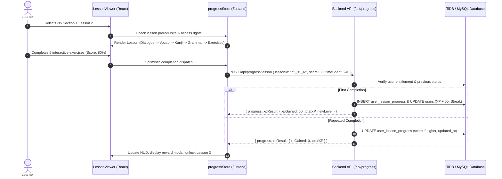
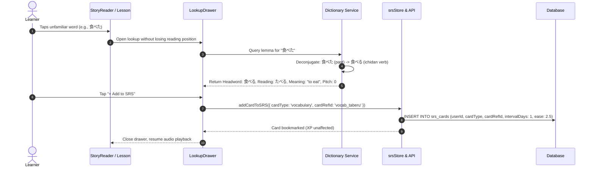

# Nihongo Master — Complete Product Transformation Blueprint

**Document Version:** 1.0.0  
**Status:** Architecture Specification & Strategy Baseline  
**Date:** 2026-10-14  
**Author:** Antigravity Architecture & Strategy Core  

---

## 1. Executive Summary & Transformation Charter

The objective of this project transformation is to elevate the current Japanese-learning web application into a world-class, gamified, curriculum-structured, multilingual learning ecosystem. 

The existing application contains exceptional individual modules:
- An SM-2 based Spaced Repetition System (SRS).
- A 6-story graded reader with tokenized furigana and pitch accent annotations.
- A 214-character interactive Kana studio with stroke animations.
- 130 canonical JLPT grammar patterns (N5–N1) with persistent study tracking.
- An interactive 2D/3D conversational companion (Hana-sensei).

However, the application suffers from critical architectural fragmentation:
1. **Disconnected Learning Flows:** The curriculum is split into isolated silos (Lessons, Kanji, Vocabulary, Grammar, and Stories operate on disparate data formats and separate progress trackers).
2. **Pedagogical Gaps:** The core structured lesson curriculum contains zero kanji characters (`kanji: []` across all 25 lessons), only 176 total vocabulary words, and abrupt content drop-offs between N5 and N4–N1.
3. **Absence of Central Lexical Search:** Despite marketing claims, no general dictionary exists; lookups are confined to hardcoded reader tokens.
4. **Gamification Vulnerabilities:** XP and life mechanics lack a unified server-authoritative life-bar system, and duplicate completions historically risked XP farming.
5. **Localization Inflexibility:** English, Tamil, and Hindi translations are embedded directly into Japanese curriculum data files, while the broader user interface is hardcoded in English with no formal i18n framework.
6. **Brand Collision:** The current name conflicts directly with `nihongomaster.com`, an established 2012 commercial platform, exposing the product to search cannibalization and trademark risk.

This blueprint establishes the end-to-end architecture, domain models, user journeys, and risk controls required to transform the platform systematically while strictly preserving every line of working, verified code.

---

## 2. Current State vs. Target State Architecture

```
┌────────────────────────────────────────────────────────────────────────────────────────┐
│                                 CURRENT ARCHITECTURE                                   │
│                                                                                        │
│   [Hardcoded English UI]    [Fragmented Datasets]    [Client-Driven XP Mutations]      │
│            │                         │                             │                   │
│   ┌────────▼────────┐       ┌────────▼────────┐           ┌────────▼────────┐          │
│   │ Monolingual UI  │       │ 176 Vocab Words │           │ No Life Bar /   │          │
│   │ No i18n Engine  │       │ 0 Kanji/Lesson  │           │ Unbounded Lives │          │
│   └─────────────────┘       └─────────────────┘           └─────────────────┘          │
│                                                                                        │
│   ┌──────────────────────────────────────────────────────────────────────────┐         │
│   │ Dictionary: Missing (Only pre-annotated tokens in 6 reader stories)       │         │
│   │ 3D Engine: 1.1MB Three.js bundle loaded across route-level code splits   │         │
│   └──────────────────────────────────────────────────────────────────────────┘         │
└────────────────────────────────────────────────────────────────────────────────────────┘
                                            │
                                  TRANSFORMATION PIVOT
                                            ▼
┌────────────────────────────────────────────────────────────────────────────────────────┐
│                                  TARGET ARCHITECTURE                                   │
│                                                                                        │
│   [Unified i18n App]         [Structured N5-N1 Path]     [Server-Authoritative Game]   │
│   • react-i18next            • 9 Sections / Level        • 100 HP Life Bar             │
│   • Isolated Locale Files    • ~45-54 Lessons / Level    • Anti-Cheat XP Idempotency   │
│   • Multilingual Glosses     • Kanji + Vocab in Context  • Weekly Promotion Leagues    │
│            │                         │                             │                   │
│   ┌────────▼─────────────────────────▼─────────────────────────────▼─────────┐          │
│   │                 CENTRAL PROGRESSION & CURRICULUM CORE                    │          │
│   │  • Unified Placement Test (<= 30% incorrect passing gate)                │          │
│   │  • Entitled Level Visibility (Gated N5 -> N1 access)                     │          │
│   │  • Bidirectional SRS sync from Lessons, Stories, and Dictionary          │          │
│   └──────────────────────────────────┬───────────────────────────────────────┘          │
│                                      │                                                 │
│   ┌──────────────────────────────────▼───────────────────────────────────────┐          │
│   │                 LEXICAL & INTELLIGENT LOOKUP ENGINE                      │          │
│   │  • Full JMdict (190k entries) + KANJIDIC2 + Tatoeba Sentence Corpus      │          │
│   │  • Rule-Based & Morphological Japanese Deconjugator                      │          │
│   │  • Non-Intrusive Contextual Drawer across all Learning Views             │          │
│   └──────────────────────────────────────────────────────────────────────────┘          │
└────────────────────────────────────────────────────────────────────────────────────────┘
```

### Detailed Dimensional Comparison

| Dimension | Current State | Target State |
| :--- | :--- | :--- |
| **Brand Identity** | "Nihongo Master" (conflicts with 2012 commercial website `nihongomaster.com`). | Distinctive, legally cleared candidate name (e.g., *KotobaQuest*, *Renwa*, *Yomikata*). |
| **Curriculum Structure** | 5 isolated lessons per level (25 total); 0 kanji in lessons; 43 total interactive questions. | 9 structured sections per level (~45–54 lessons/level; 240+ total); unified dialogue, kanji, vocab, grammar, and quiz. |
| **Curriculum Data** | 940 kanji (429 missing examples), 176 vocab, 130 grammar, 6 stories. | 2,136 Jōyō Kanji with compounds, 8,000+ vocabulary lemmas, 500+ grammar patterns, 30+ graded readers. |
| **Lexical Lookup** | Modal popover limited to pre-tokenized words in 6 stories. | Dedicated `/dictionary` route + contextual floating lookup drawer; English/Romaji/Kana search; deconjugation engine. |
| **Progression & Access** | All levels visible; user can freely click into N1 lessons; no placement testing. | Gated level visibility; server-verified 30-question diagnostic placement test (<= 30% error threshold). |
| **Lives & Game Loop** | No lives or health bar; unlimited immediate quiz trials; no XP penalties. | 100 HP life bar (-10 HP per mistake); 3 mistakes trigger XP penalty; zero-life practice recovery mode. |
| **XP & Security** | Server validates event types and rejects arbitrary amounts; idempotent repeat XP. | Unified server-authoritative engine; transactional attempt logging; anti-cheat token validation. |
| **Internationalization** | Hardcoded English UI; Tamil and Hindi translations embedded inside N5 JS data objects. | Strict 3-tier separation: canonical Japanese source, localized strings (`locales/*.json`), user preferences. |
| **3D & Performance** | Three.js + VRM loaded across multiple app routes (1.1 MB minified). | Three.js strictly isolated to `/sensei` studio; 0 kB Three.js overhead on text-first reading and study pages. |

---

## 3. End-to-End User Journey Tracing

### Journey 1: Guided Lesson & Interactive Checkpoint


### Journey 2: Quiz with 100 HP Life Bar & Penalty Mechanics
```mermaid
sequenceDiagram
    autonumber
    actor User as Learner
    participant Quiz as QuizEngine (React)
    participant Life as gameStore (Lives & Health)
    participant API as Backend API (/api/progress/quiz)
    participant DB as Database

    User->>Quiz: Answers question incorrectly
    Quiz->>Life: Deduct 10 HP (Current HP: 90 -> 80)
    alt Health > 0
        Life-->>Quiz: Play error haptic/sfx, shake UI, continue quiz
    else Health reaches 0 HP
        Life-->>Quiz: Trigger Out-of-Lives Modal
        Quiz-->>User: Abort quiz; redirect to "Practice Dojo" for HP recovery
    end
    User->>Quiz: Finishes quiz with 85% score (1 mistake = 90 HP left)
    Quiz->>API: POST /api/progress/quiz/submit { quizId, score: 85, mistakes: 1, answers }
    API->>DB: Validate answers server-side, check attempt idempotency
    API->>DB: Record user_quiz_attempt & award delta XP
    API-->>Quiz: Authoritative result payload
```

### Journey 3: Interactive Word Lookup & Add to SRS


---

## 4. Preservation of Existing Core Assets

Under no circumstances should existing, validated functionality be discarded or rewritten from scratch. The following modules must be treated as canonical baseline assets:

1. **The 6 Graded Readers (`src/data/reading/`):**
   - 52 manually validated sentences with complete token boundaries, furigana mappings, Tokyo pitch accents, and 24 comprehension questions.
   - Preserved in full; utilized as the structural template for N3–N1 story authoring.
2. **The 214-Character Kana Studio (`src/data/kana/`):**
   - Complete Hiragana and Katakana charts with stroke order definitions and audio pronunciation.
3. **The 130 Canonical Grammar Patterns (`src/data/grammar/`):**
   - N5 (60), N4 (15), N3 (15), N2 (20), N1 (20) with newly implemented persistent progress tracking.
4. **The SM-2 SRS Engine (`src/store/srsStore.ts`, `backend/src/routes/srs.ts`):**
   - Correct interval multiplication, ease factor scaling (1.3 to 2.5), review scheduling, and queue aggregation.
5. **The 77-Word Verified Tokyo Pitch Accent Corpus (`src/data/pitch/pitchData.js`):**
   - Failsafe fallback architecture (returns `null` rather than speculative pitch curves).
6. **2D Hana-Sensei Character Architecture (`HanaSenseiCharacter2D.tsx`):**
   - Low-overhead, high-emotion sprite system providing responsive AI companionship on mobile and low-power devices.

---

## 5. Architectural Transformation Pillars

```
┌─────────────────────────────────────────────────────────────────────────────┐
│                       SIX TRANSFORMATION PILLARS                            │
├─────────────────────┬───────────────────────────┬───────────────────────────┤
│ 1. Rebrand &        │ 2. Multilingual           │ 3. 9-Section Curriculum   │
│    Legal Integrity  │    Data Separation        │    Progression (N5-N1)    │
│    Distinct name &  │    i18n engine, decoupled │    Structured roadmap,    │
│    cleared marks.   │    source & translations. │    kanji integrated.      │
├─────────────────────┼───────────────────────────┼───────────────────────────┤
│ 4. Placement &      │ 5. Authoritative Lives    │ 6. Lexical Lookup &       │
│    Gated Visibility │    & Anti-Cheat Loop      │    Deconjugation          │
│    Server-validated │    100 HP bar, delta XP,  │    JMdict + Tatoeba core, │
│    diagnostic test. │    practice recovery.     │    contextual drawer.     │
└─────────────────────┴───────────────────────────┴───────────────────────────┘
```

1. **Rebrand & Legal Integrity:** Establish an original, trademark-cleared product identity, domain strategy, and licensing compliance framework.
2. **Multilingual Data Architecture:** Strictly decouple Japanese linguistic source data from localized strings and user preferences.
3. **Curriculum Roadmap:** Expand from 25 isolated lessons to 240+ cohesive lessons organized into 9 progressive sections per JLPT level.
4. **Placement Testing & Level Gating:** Implement a server-validated diagnostic onboarding exam unlocking only earned content tiers.
5. **Authoritative Gamification (Lives & XP):** Institute a 100 HP life bar, safe mistake penalties, anti-cheat attempt logging, and recovery dojos.
6. **Lexical Lookup & Deconjugation:** Deploy a full-scale Japanese dictionary with rule-based inflection parsing and non-intrusive popover mechanics.
