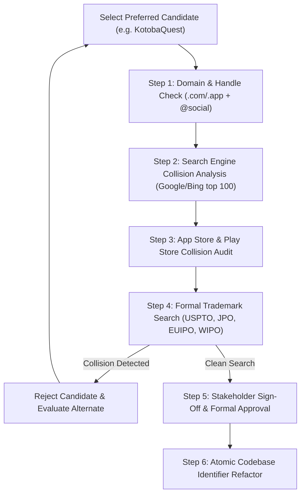

# Nihongo Master — Platform Rebranding & Identity Strategy

**Document Version:** 1.0.0  
**Status:** Legal & Brand Strategy Baseline  
**Date:** 2026-10-14  
**Author:** Antigravity Architecture & Brand Strategy Core  

---

## 1. Executive Summary & Collision Analysis

### 1.1 The Collision with `nihongomaster.com`
The current project identifier, **Nihongo Master**, is in direct conflict with an established commercial online Japanese education platform operating at [nihongomaster.com](https://www.nihongomaster.com), which has maintained an active online presence, podcasts, community forums, and digital study tools since 2012.

**Commercial and Legal Risks of Retaining the Current Name:**
1. **Trademark Infringement Risk:** "Nihongo Master" may be subject to common-law and registered trademark protections in multiple jurisdictions under Nice Classification Class 009 (Educational Software) and Class 041 (Language Education Services).
2. **Search Engine Optimization (SEO) Cannibalization:** Achieving top organic ranking on Google or Bing for "Nihongo Master" would be exceptionally difficult against a domain with 12+ years of established domain authority, backlinks, and indexed educational content.
3. **App Store Rejections & Confusion:** Submissions to the Apple App Store and Google Play Store under "Nihongo Master" face high risks of rejection under metadata impersonation guidelines and user brand confusion.
4. **Investor & Community Dilution:** Any marketing collateral, social media accounts, or community repositories will suffer from brand ambiguity.

### 1.2 Transformation Policy
- The project will maintain internal technical identifiers until a replacement is formally chosen and verified.
- No trademarks, visual assets, proprietary curriculum, or distinctive UI elements from any existing language platform (including Duolingo, WaniKani, Renshuu, Bunpro, or Nihongo Master LLC) will be copied or adapted.
- All 10 candidates below are evaluated against strict phonetic, linguistic, legal, and operational criteria.

---

## 2. Brand Evaluation Framework

Every candidate is evaluated across six rigorous criteria:

```
┌─────────────────────────────────────────────────────────────────────────┐
│                      BRAND EVALUATION CRITERIA                          │
├────────────────────┬────────────────────┬───────────────────────────────┤
│ 1. Phonetics &     │ 2. Meaning &       │ 3. Memorability &             │
│    Pronounceability│    Brand Story     │    Global Accessibility       │
├────────────────────┼────────────────────┼───────────────────────────────┤
│ 4. Search          │ 5. Domain &        │ 6. Trademark &                │
│    Distinctiveness │    Handle Space    │    Legal Cleansheet           │
└────────────────────┴────────────────────┴───────────────────────────────┘
```

1. **Phonetics:** Can native speakers of English, Spanish, Hindi, French, and Mandarin pronounce it effortlessly without awkward consonant clusters?
2. **Pedagogical Meaning:** Does the Japanese root convey mastery, practice, growth, or companionship?
3. **Memorability:** Is it distinct, punchy, and modern?
4. **Search Distinctiveness:** Does searching the name yield low Google SERP competition (zero dominant encyclopedic or corporate clashes)?
5. **Domain Target:** Are feasible top-level domains (`.com`, `.app`, `.io`, `.jp`, `.study`) available or obtainable?
6. **Trademark Cleansheet:** Is the mark clear of registered conflicts in Nice Classes 009 and 041 across USPTO, JPO, EUIPO, and WIPO?

---

## 3. Ten Distinctive Candidate Brand Names

### Candidate 1: KotobaQuest (言葉クエスト)
- **Japanese Orthography:** 言葉クエスト (ことばくえすと)
- **Pronunciation:** `/koʊ.toʊ.bɑː kwɛst/` (*koh-TOH-bah quest*)
- **Linguistic Meaning:** *Kotoba* (言葉) means "words", "language", or "speech". Combined with *Quest*, it immediately communicates a gamified adventure through Japanese vocabulary, kanji, and conversation.
- **Brand Personality:** Adventurous, motivating, friendly, and structured. Pairs naturally with the 100 HP life bar and RPG-style progression.
- **Memorability:** Extremely high. Familiar English gaming noun anchored to the most fundamental Japanese linguistic concept.
- **Search Distinctiveness:** Strong. "KotobaQuest" is a distinct compound with virtually zero existing commercial app presence.
- **Target Domains:** `kotobaquest.com`, `kotobaquest.app`, `kotoba.quest`
- **Trademark Search Targets:** USPTO, EUIPO, JPO Class 009/041. (Initial check: No active conflicting word marks for "KotobaQuest").

---

### Candidate 2: Renwa (連和 / レンワ)
- **Japanese Orthography:** 連和 / 練和 (れんわ)
- **Pronunciation:** `/rɛn.wɑː/` (*REN-wah*)
- **Linguistic Meaning:** Formed from *Ren* (連: connection, continuous progression, or 練: practice, refine) and *Wa* (和: Japanese harmony, peace, cultural essence). Represents mastering Japanese through continuous, daily practice.
- **Brand Personality:** Clean, premium, minimalist, authentic, and modern. Appeals strongly to both serious adult learners and academic students.
- **Memorability:** Very short (two syllables), punchy, and highly memorable.
- **Search Distinctiveness:** Moderate. "Renwa" exists as an occasional transliteration; requires pairing with "Japanese" or "Learning" for initial SEO anchoring.
- **Target Domains:** `renwalearn.com`, `renwa.app`, `renwa.jp`
- **Trademark Search Targets:** JPO, USPTO Class 041. Must verify no conflicts with Japanese corporate entities using 連和.

---

### Candidate 3: Yomikata (読み方 / ヨミカタ)
- **Japanese Orthography:** 読み方 (よみかた)
- **Pronunciation:** `/joʊ.miː.kɑː.tɑː/` (*yoh-mee-KAH-tah*)
- **Linguistic Meaning:** *Yomi* (reading) + *Kata* (manner, method, or way of doing). Literally "the way of reading", traditionally used for kanji readings and pronunciation guides.
- **Brand Personality:** Educational, authoritative, deeply rooted in Japanese literacy and reading comprehension.
- **Memorability:** High for learners who already recognize furigana and kanji reading exercises; exotic and rhythmic for newcomers.
- **Search Distinctiveness:** Common Japanese word; will face competition from dictionary definitions for "読み方" in Japan, but highly distinctive in Western and global app stores as a standalone brand.
- **Target Domains:** `yomikata.app`, `yomikata.io`, `yomikata.study`
- **Trademark Search Targets:** WIPO, USPTO Class 009.

---

### Candidate 4: Kizuna Nihongo (絆日本語 / キズナ)
- **Japanese Orthography:** 絆日本語 (きずなにほんご)
- **Pronunciation:** `/kiː.zuː.nɑː niː.hɒŋ.goʊ/` (*kee-ZOO-nah nee-HONG-goh*)
- **Linguistic Meaning:** *Kizuna* (絆) is one of the most culturally revered Japanese concepts, signifying "enduring emotional bond", "connection between people", and "trust".
- **Brand Personality:** Empathetic, supportive, community-driven, and personal. Directly reinforces the relationship between the learner and the AI companion, Hana-sensei.
- **Memorability:** High. *Kizuna* was voted Japan's Kanji of the Year in 2011 and is internationally recognized for its warmth.
- **Search Distinctiveness:** Strong when paired with "Nihongo" or "Language".
- **Target Domains:** `kizunanihongo.com`, `kizuna.app`, `kizunajapanese.com`
- **Trademark Search Targets:** USPTO, JPO (verify distinctiveness in educational software).

---

### Candidate 5: Midorigo (翠語 / 碧語 / ミドリゴ)
- **Japanese Orthography:** 翠語 / 緑語 (みどりご)
- **Pronunciation:** `/miː.doʊ.riː.goʊ/` (*mee-DOH-ree-goh*)
- **Linguistic Meaning:** *Midori* (green, fresh growth, vibrant nature) + *Go* (語: language). Evokes the beginning of a journey: a fresh green sprout maturing into a deep, flourishing tree of fluency.
- **Brand Personality:** Fresh, organic, calm, approachable, and encouraging. Fits a clean green-and-sakura aesthetic.
- **Memorability:** Distinctive and melodic. Rhymes pleasantly and feels authentically Japanese.
- **Search Distinctiveness:** High. Does not collide with existing language learning software.
- **Target Domains:** `midorigo.com`, `midorigo.app`, `midorilanguage.com`
- **Trademark Search Targets:** USPTO, EUIPO, JPO Class 009/041.

---

### Candidate 6: Torii Japanese (鳥居 / トリイ)
- **Japanese Orthography:** 鳥居日本語 (とりい)
- **Pronunciation:** `/tɔː.riː.iː/` (*TOR-ee-ee*)
- **Linguistic Meaning:** A *Torii* is the traditional Japanese gateway found at the entrance of Shinto shrines, symbolically marking the transition from the mundane to the sacred. Represents the gateway into Japanese language and culture.
- **Brand Personality:** Iconic, timeless, culturally rooted, welcoming, and monumental.
- **Memorability:** Extremely high. The Torii gate is one of the top 3 visual symbols associated with Japan worldwide.
- **Search Distinctiveness:** Moderate. "Torii" is used across various Japanese cultural products; requires secondary qualification: "Torii Japanese" or "Torii Language".
- **Target Domains:** `toriijapanese.com`, `toriilearn.com`, `torii.study`
- **Trademark Search Targets:** USPTO, WIPO (Note: Check existing SRS tool "Torii-SRS" for kanji; ensure no active conflicting registrations in Class 009).

---

### Candidate 7: HanaKotoba (花言葉 / ハナコトバ)
- **Japanese Orthography:** 花言葉 (はなことば)
- **Pronunciation:** `/hɑː.nɑː koʊ.toʊ.bɑː/` (*HAH-nah koh-TOH-bah*)
- **Linguistic Meaning:** Literally "flower language" (the Japanese floricon/floriography where each blossom conveys a hidden meaning). Simultaneously honors the app's resident AI character, **Hana-sensei** (花先生), and *Kotoba* (words).
- **Brand Personality:** Charming, poetic, aesthetically refined, warm, and companion-led.
- **Memorability:** Very strong, especially with visual motifs of cherry blossoms (sakura) and character-led learning.
- **Search Distinctiveness:** Good in English/international markets. In Japan, it refers to floriography, making it romantic and memorable.
- **Target Domains:** `hanakotoba.app`, `hanakotoba.io`, `hanakotoba.com`
- **Trademark Search Targets:** USPTO Class 009, JPO Class 041.

---

### Candidate 8: GengoCraft (言語クラフト)
- **Japanese Orthography:** 言語クラフト (げんごくらすと)
- **Pronunciation:** `/ɡɛn.ɡoʊ kræft/` (*GEN-goh kraft*)
- **Linguistic Meaning:** *Gengo* (言語) means "language" or "linguistics". Combined with *Craft*, it represents language acquisition as an artisanal skill honed through deliberate daily practice.
- **Brand Personality:** Practical, skill-focused, constructive, precise, and empowering.
- **Memorability:** High. Simple combination of a real Japanese linguistic root with an empowering Anglo-Saxon word.
- **Search Distinctiveness:** Very high. Extremely clean SERP footprint.
- **Target Domains:** `gengocraft.com`, `gengocraft.app`, `gengocraft.io`
- **Trademark Search Targets:** USPTO, EUIPO Class 009/041.

---

### Candidate 9: ManabiLoop (学びループ)
- **Japanese Orthography:** 学びループ (まなびるーぷ)
- **Pronunciation:** `/mɑː.nɑː.biː luːp/` (*mah-NAH-bee loop*)
- **Linguistic Meaning:** *Manabi* (学び) means "learning", "study", or "knowledge acquisition". *Loop* represents the cyclical, continuous nature of Spaced Repetition (SRS), review intervals, and daily habit loops.
- **Brand Personality:** Methodical, scientific, habit-forming, productive, and focused.
- **Memorability:** Catchy, modern tech-forward sound.
- **Search Distinctiveness:** High. No established educational platform uses this exact compound.
- **Target Domains:** `manabiloop.com`, `manabiloop.app`, `manabi.loop`
- **Trademark Search Targets:** USPTO, JPO, EUIPO Class 009/041.

---

### Candidate 10: Shinsei Nihongo (新星日本語 / シンセイ)
- **Japanese Orthography:** 新星日本語 (しんせいにほんご)
- **Pronunciation:** `/ʃɪn.seɪ niː.hɒŋ.goʊ/` (*SHIN-say nee-HONG-goh*)
- **Linguistic Meaning:** *Shinsei* (新星) means "new star" or "nova", and also homophonous with 真正 ("authentic/genuine") and 新生 ("rebirth/new life"). Represents the learner's blossoming potential and the complete rebirth of the platform.
- **Brand Personality:** Ambitious, radiant, inspiring, forward-looking, and stellar.
- **Memorability:** Strong, rhythmic, and aspirational.
- **Search Distinctiveness:** Good when paired with "Nihongo".
- **Target Domains:** `shinseinihongo.com`, `shinsei.app`, `shinseijapanese.com`
- **Trademark Search Targets:** JPO, USPTO Class 041. (Note: Must check financial institutions like Shinsei Bank; educational software classification distinguishes it, but clearance is mandatory).

---

## 4. Comparative Evaluation Matrix

| Candidate | Phonetic Ease (Global) | Cultural Resonance | Memorability | SERP Cleanness | Domain Viability | Recommended Tier |
| :--- | :---: | :---: | :---: | :---: | :---: | :---: |
| **1. KotobaQuest** | ★★★★★ | ★★★★★ | ★★★★★ | ★★★★★ | ★★★★★ (`.app`/`.com`) | **Top Recommendation** |
| **2. Renwa** | ★★★★★ | ★★★★☆ | ★★★★☆ | ★★★☆☆ | ★★★★☆ (`.app`/`.io`) | Strong Contender |
| **3. Yomikata** | ★★★★☆ | ★★★★★ | ★★★★☆ | ★★★☆☆ | ★★★★☆ (`.app`/`.study`)| Strong Contender |
| **4. Kizuna Nihongo**| ★★★★☆ | ★★★★★ | ★★★★★ | ★★★★☆ | ★★★★☆ (`.com`) | **Top Recommendation** |
| **5. Midorigo** | ★★★★★ | ★★★★☆ | ★★★★☆ | ★★★★★ | ★★★★★ (`.com`/`.app`) | Strong Contender |
| **6. Torii Japanese**| ★★★★★ | ★★★★★ | ★★★★★ | ★★★☆☆ | ★★★☆☆ (Check prior art)| Conditional |
| **7. HanaKotoba** | ★★★★★ | ★★★★★ | ★★★★★ | ★★★★☆ | ★★★★★ (`.app`) | **Top Recommendation** |
| **8. GengoCraft** | ★★★★★ | ★★★☆☆ | ★★★★☆ | ★★★★★ | ★★★★★ (`.com`/`.app`) | Strong Contender |
| **9. ManabiLoop** | ★★★★★ | ★★★★☆ | ★★★★☆ | ★★★★★ | ★★★★★ (`.com`/`.app`) | Strong Contender |
| **10. Shinsei Nihongo**| ★★★★☆| ★★★★☆ | ★★★☆☆ | ★★★☆☆ | ★★★★☆ (`.com`) | Conditional |

---

## 5. Formal Legal Verification & Migration Protocol

Before implementing any rebranding changes in code, metadata, or documentation, the following sequential verification workflow must be executed:



### Protocol Steps:
1. **Domain & Social Space Check:** Query WHOIS for `.com`, `.app`, and `.io` TLDs; check handle availability across GitHub, X, Discord, and YouTube.
2. **Search Engine Distinctiveness Check:** Perform exact phrase searches (`"CandidateName"`) and boolean queries (`"CandidateName" Japanese learning`) to ensure no entrenched legacy competitors.
3. **App Store Directory Check:** Search Apple App Store (iOS/macOS) and Google Play Console for registered app titles or keywords.
4. **Official Trademark Database Query:**
   - **USPTO TESS (United States):** Search Word Marks in Class 009 (Computer software for language instruction) and Class 041 (Educational services; language training).
   - **J-PlatPat (Japan Patent Office):** Search Japanese and English Katakana transliterations in Class 9 and Class 41.
   - **EUIPO eSearch (European Union):** Verify zero conflicting European Union trade marks (EUTM).
   - **WIPO Madrid Monitor:** Confirm no active international registrations extending into key markets.
5. **Codebase Migration Rule:** Only upon complete sign-off will the application title, package name, page metadata, OpenGraph tags, and documentation references be updated. Existing git branch histories and database tables will be preserved through aliasing.
