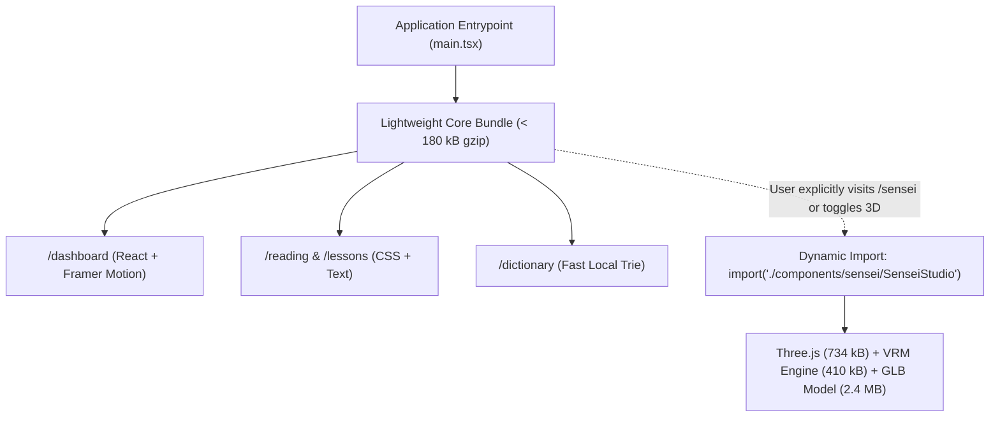

# Nihongo Master — UI Design System, Experience & Performance Plan

**Document Version:** 1.0.0  
**Status:** Visual Design & Performance Architecture Baseline  
**Date:** 2026-10-14  
**Author:** Antigravity UI/UX & Web Performance Core  

---

## 1. Executive Summary & Design System Charter

The current user interface features capable components, but exhibits visual clutter, redundant metric cards, inconsistent typography scales, and excessive asset weight. Notably, the Three.js and VRM rendering dependencies (`three`: 734 kB minified, `@pixiv/three-vrm`: 410 kB minified) risk degrading performance if not strictly isolated from core reading and learning views.

This specification establishes:
1. An elegant, WCAG 2.1 AA certified **Japanese Design System** focused on typographic hierarchy, comfortable kana/kanji legibility, and high-contrast semantic palettes.
2. A **Node-Based Learning Roadmap Dashboard** replacing fragmented tiles with an intuitive, progression-driven learning tree.
3. A page-by-page redesign across all 10 primary functional areas.
4. A **Strict 3D Asset Isolation Strategy** ensuring that text-first reading and dictionary pages load instantly with 0 kB Three.js runtime overhead.
5. High-polish, non-blocking gamification animations (celebrations, daily quests, leagues) built with CSS and Framer Motion that adhere strictly to `prefers-reduced-motion`.

---

## 2. Design System Foundations: Typography & Color Tokens

### 2.1 Japanese Typography Hierarchy
Rendering Japanese scripts (Kanji, Hiragana, Katakana) requires careful consideration of font weights, line heights, and character spacing to prevent glyph blurriness and visual fatigue.

```css
/* Typography Scale & Font Stacks */
:root {
  --font-japanese: "Hiragino Sans", "Hiragino Kaku Gothic ProN", "Noto Sans JP", "Yu Gothic", "Meiryo", sans-serif;
  --font-latin: -apple-system, BlinkMacSystemFont, "Segoe UI", Roboto, "Helvetica Neue", sans-serif;
  --font-display: "Shippori Mincho", "Hiragino Mincho ProN", serif;
  
  /* Furigana vertical offset and sizing */
  --ruby-font-size: 0.58em;
  --ruby-line-height: 1.1;
  --ruby-spacing: 0.04em;
}

/* Ensure ruby annotations do not distort line-height */
ruby {
  ruby-align: center;
  ruby-position: over;
}
rt {
  font-size: var(--ruby-font-size);
  color: var(--color-ruby-text);
  user-select: none;
}
```

### 2.2 Refined Semantic Palette (Light & Dark Mode)
All color combinations strictly exceed the **WCAG 2.1 AA contrast ratio of 4.5:1** for standard text and 3:1 for large graphical elements.

```
┌────────────────────────────────────────────────────────────────────────┐
│                        SEMANTIC PALETTE TOKENS                         │
├────────────────────┬────────────────────┬──────────────────────────────┤
│ Token Name         │ Light Mode Hex     │ Dark Mode Hex (Surface)      │
├────────────────────┼────────────────────┼──────────────────────────────┤
│ **Canvas / Bg**    │ `#FBFBFA` (Washi)  │ `#0F172A` (Slate Midnight)   │
│ **Surface Card**   │ `#FFFFFF` (Pure)   │ `#1E293B` (Elevated Navy)    │
│ **Foreground Text**│ `#18181B` (Sumi)   │ `#F8FAFC` (Pure Pearl)       │
│ **Muted Text**     │ `#71717A` (Charcoal)│ `#94A3B8` (Cool Grey)       │
│ **Crimson Torii**  │ `#E11D48` (Primary)│ `#FB7185` (Soft Rose)        │
│ **Matcha Green**   │ `#10B981` (Mastered│ `#34D399` (Vibrant Emerald)  │
│ **Indigo Blue**    │ `#3B82F6` (Grammar)│ `#60A5FA` (Sky Blue)         │
│ **Amber Gold**     │ `#F59E0B` (XP/Streak) `#FBBF24` (Radiant Gold)    │
└────────────────────┴────────────────────┴──────────────────────────────┘
```

---

## 3. Page-by-Page Redesign Specifications

### 3.1 Dashboard & Learning Roadmap
- **Problem:** Current dashboard scatters 4 redundant stats tiles, multiple unrelated section buttons, and two separate progress bars across a busy grid.
- **Redesign:**
  - **Persistent HUD:** Sticky top status bar showing [Level Badge (N5)], [100 HP Life Bar], [Streak Flame with Freeze count], and [Total XP].
  - **Node-Based Learning Tree:** A single, continuous vertical path (inspired by modern progression paths) winding through Section 1 to Section 9. Each circular node represents a lesson, milestone quiz, or story, displaying its state: *Active (pulsing)*, *Completed (golden checkmark)*, or *Locked (padlock)*.
  - **Daily Quest Drawer:** Floating card on desktop right sidebar tracking the 3 daily quests with real-time XP counters.

```
┌────────────────────────────────────────────────────────────────────────┐
│ [N5]  💚 100/100 HP  🔥 7 Days (❄️ 1)  ⭐ 1,420 XP       [Settings ⚙️] │
├────────────────────────────────────────────────────────────────────────┤
│                          SECTION 1: DAILY GREETINGS                    │
│                                                                        │
│                              ( 1.1 ) [✓]                               │
│                                 \                                      │
│                                  ( 1.2 ) [✓]                           │
│                                    /                                   │
│                              ( 1.3 ) [▶ PULSING]                       │
│                                 \                                      │
│                                  ( 1.4 ) [🔒]                          │
│                                    /                                   │
│                              [🏆 SECTION EXAM]                         │
│                                                                        │
│                      ── NEXT UP: SECTION 2: FAMILY ──                  │
└────────────────────────────────────────────────────────────────────────┘
```

### 3.2 Lesson Viewer & Lesson Exit Quiz
- **Distraction-Free Reading Mode:** Full-viewport clean reading layout with a top progress line indicator.
- **Interactive Checkpoints:** Inline multiple-choice checks appear inside the dialogue, allowing immediate application of grammar rules.
- **Keyboard-First Controls:** Full keyboard navigation:
  - `1`, `2`, `3`, `4` to select quiz options.
  - `Space` to replay audio.
  - `Enter` to confirm answer and advance to next slide.
  - `Escape` to close drawers or return to lesson menu.

### 3.3 Grammar, Vocabulary & Kanji Reference Pages
- **Unified Filter Bar:** Sticky search header with level chips (N5–N1), tag filters, and a status toggle (*All*, *Studied*, *Mastered*).
- **Kanji Stroke Order Integration:** Lazy-loaded vector KanjiVG stroke sequences embedded directly in kanji detail panels with play/pause and step-by-step stroke breakdown.
- **De-cluttered Cards:** Removal of redundant labels; cards emphasize clean Japanese orthography with interactive furigana toggles.

### 3.4 Dedicated `/dictionary` Section
- **Multi-Script Universal Input:** Live search bar with debounced client-side prefix matching (<5ms) and backend full-text fallback.
- **Sense Decomposition:** Displays clear part-of-speech tags, numbered definitions, antonyms, transitive/intransitive pairs, and JLPT rank pills.
- **Interactive Compounds:** All kanji in headwords are clickable, opening their respective radical breakdown and stroke count.

### 3.5 Graded Readers (Stories)
- **Audio-Synchronized Karaoke Highlighting:** Current sentence highlights gently with smooth CSS backdrop transition while audio plays.
- **Instant Lexical Lookup Drawer:** Underlined words open the non-intrusive bottom drawer on tap, softly pausing narration without resetting sentence scroll.
- **Comprehension Checkpoints:** 4-question interactive reading quiz with instant answer feedback and score persistence.

### 3.6 Settings, Progress & Weekly Leagues
- **Settings Consolidation:** Grouped into clear categories (Language & Scripts, Audio & Speech, Study Goals, Notifications, Data & Privacy).
- **Weekly League Leaderboard:** 30-student weekly tier table clearly displaying Promotion Zone (top 7 in gold), Relegation Zone (bottom 5 in red), and personal rank indicator.

---

## 4. 3D Virtual Sensei & Asset Performance Architecture

The current build compiles Three.js (`three`: 734 kB) and Sensei character scripts (`SenseiCharacter`: 410 kB) into the application. If loaded on initial landing or core reading pages, this imposes unacceptable bundle penalties and battery drain on mobile learners.



### Performance Rules:
1. **Zero 3D on Core Learning Pages:** `ReadingPage`, `LessonViewer`, `KanjiPage`, and `DictionaryPage` will never import or execute Three.js. They utilize responsive, high-framerate 2D sprite expressions (`HanaSenseiCharacter2D.tsx`) which require < 15 kB.
2. **Explicit Lazy-Loading for 3D Studio:** Three.js and `@pixiv/three-vrm` are encapsulated strictly inside `React.lazy(() => import('./components/sensei/SenseiGLBLoader'))`, triggered only when navigating to `/sensei` or opting into the 3D companion in Settings.
3. **Cumulative Layout Shift (CLS) Target:** CLS < 0.05 across all views. Skeletons and layout containers must have fixed aspect ratios before remote font or image loading finishes.
4. **First Contentful Paint (FCP) Target:** FCP < 1.2s on standard mobile 4G networks.

---

## 5. Non-Blocking Gamification Animations & Accessibility

Animations must celebrate student progress without delaying learning or causing motion sickness:

1. **Non-Blocking XP Toasts:** XP awards and level-ups float unobtrusively at the top-right or bottom-center. They do not freeze the UI or block keyboard input.
2. **Confetti Burst Budget:** Milestone celebrations (`canvas-confetti`) fire a maximum of 60 particles for 1.8 seconds, immediately releasing animation frames.
3. **`prefers-reduced-motion` Compliance:**
   - All Framer Motion variants and CSS keyframe animations respect the operating system's reduced-motion preference:
   ```css
   @media (prefers-reduced-motion: reduce) {
     *, ::before, ::after {
       animation-duration: 0.01ms !important;
       animation-iteration-count: 1 !important;
       transition-duration: 0.01ms !important;
     }
   }
   ```
   - When reduced motion is enabled, all slide and scale transitions instantly snap to finished opacity states.
