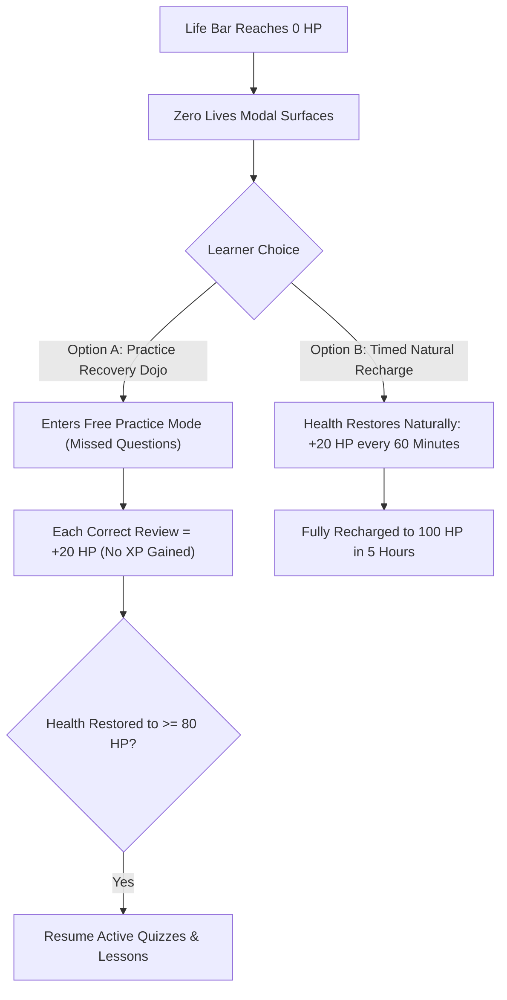

# Nihongo Master — Server-Authoritative Gamification, Lives & Assessment Engine

**Document Version:** 1.0.0  
**Status:** Game Mechanics & Security Architecture Baseline  
**Date:** 2026-10-14  
**Author:** Antigravity Progression & Security Core  

---

## 1. Executive Summary & Security Charter

A compelling language-learning experience balances emotional engagement, continuous motivation, and pedagogical discipline. In the past, the platform suffered from game loop vulnerabilities: arbitrary client-supplied XP amounts, repeatable completion farming, unpersisted quiz results, and the absence of a meaningful penalty/stakes system.

This specification institutes a unified, **Server-Authoritative Gamification Engine** featuring:
1. A **100-Point Life Bar** system that penalizes careless guessing without punitive dead-ends.
2. An explicit, safe **Mistake Penalty Rule** (15 XP penalty every 3 mistakes, clamped to non-negative balances).
3. **Transaction-Safe Idempotency** for all lesson, quiz, and milestone reward endpoints.
4. An empowering **Zero-Lives Recovery Flow** ("Practice Dojo" that restores health through active recall).
5. Comprehensive **Guest vs. Authenticated Sync Rules** with zero progress loss upon account registration.

---

## 2. The 100-Point Life Bar System

```
┌────────────────────────────────────────────────────────────────────────┐
│                        100-POINT LIFE BAR HUD                          │
│                                                                        │
│   💚 HEALTH: [████████████████████████████████████████] 100 / 100 HP   │
│                                                                        │
│   • Base Health: 100 HP                                                │
│   • Incorrect Answer Cost: -10 HP                                      │
│   • 3 Incorrect Answers Cost: -30 HP + 15 XP Penalty                   │
│   • 0 HP (10 Mistakes): Quiz Aborts -> Redirects to Practice Dojo      │
└────────────────────────────────────────────────────────────────────────┘
```

### 2.1 Game Loop Mechanics
- **Initial Health:** Every user begins each lesson quiz or assessment session with **100 HP**.
- **Incorrect Answer Deduction:** Each incorrect response immediately deducts **10 HP**. The user receives instant audio/visual corrective feedback with the correct explanation.
- **The Every-3-Mistakes Rule:**
  - Upon logging the 3rd, 6th, and 9th mistake within a single quiz session, the engine triggers an additional **15 XP penalty**.
  - **Zero-Floor Protection Rule:** To prevent student demoralization or negative integer balances, total user XP is strictly clamped at zero:
    $$\text{UserXP}_{\text{new}} = \max(0, \text{UserXP}_{\text{current}} - 15)$$
    Negative XP balances are structurally prohibited in database column constraints and server logic.
- **Session Duration:** Quizzes are calibrated for **2 to 10 minutes** (5 to 15 questions depending on lesson type), with an optional countdown timer for review challenges.

### 2.2 Zero Lives (0 HP) & The Practice Recovery Flow
When a user makes 10 mistakes in a single session, their health reaches **0 HP**. The platform rejects punitive paywalls or arbitrary lockout timers in favor of pedagogical reinforcement:



1. **The Practice Recovery Dojo:** The learner is seamlessly transitioned to a review session featuring the exact questions, kanji, and grammar points missed during the failed session. Every successful recall restores **+20 HP**. Upon reaching 80 HP, the student is qualified to retry the lesson quiz.
2. **Passive Regeneration:** For learners stepping away from the app, lives regenerate passively at a rate of **20 HP every 60 minutes**, achieving a full 100 HP restore within 5 hours.

---

## 3. Server-Authoritative Reward Matrix

XP amounts are non-negotiable server constants defined in `backend/src/services/progressCalculator.ts`. The client has zero authority over XP calculations.

| Learning Event | Trigger Condition | Server XP Award | Idempotency / Repetition Rule |
| :--- | :--- | :---: | :--- |
| **Lesson Perfect** | Score >= 90% on lesson exercises | **15 XP** | Awarded once per lesson. Repeat completions award 0 XP. |
| **Lesson Great** | Score >= 80% on lesson exercises | **12 XP** | Awarded once per lesson. Repeat completions award 0 XP. |
| **Lesson Good** | Score >= 60% on lesson exercises | **8 XP** | Awarded once per lesson. Repeat completions award 0 XP. |
| **Lesson Pass** | Score < 60% (completed, passed) | **3 XP** | Awarded once per lesson. Repeat completions award 0 XP. |
| **Quiz Perfect** | 100% on exit quiz (0 mistakes) | **12 XP** | Delta scoring: awards `max(0, newScoreXP - previousBestXP)`. |
| **Quiz Great** | 80%–99% on exit quiz | **8 XP** | Delta scoring only. |
| **Quiz Pass** | 60%–79% on exit quiz | **4 XP** | Delta scoring only. |
| **New Kanji Learned** | First time studying kanji in lesson/page | **8 XP** | Idempotent: 8 XP on first study, 0 XP thereafter. |
| **New Vocab Learned** | First time studying vocab in lesson/page | **4 XP** | Idempotent: 4 XP on first study, 0 XP thereafter. |
| **New Kana Learned** | First time completing kana card | **4 XP** | Idempotent: 4 XP on first study, 0 XP thereafter. |
| **New Grammar Studied** | First time studying grammar pattern | **6 XP** | Idempotent: 6 XP on first study, 0 XP thereafter. |
| **SRS Correct Review** | Successfully recalling card in `/review` | **2 XP** | Awarded on actual recall. Bookmarking (+SRS) awards 0 XP. |
| **SRS Easy Review** | Rating card "Easy" during review | **3 XP** | Awarded on actual recall. |
| **SRS Mastered** | Card reaches SRS Interval >= 21 days | **5 XP** | Awarded upon achieving Mastered milestone. |
| **Daily Goal Done** | Reaching daily XP target (e.g., 20 XP) | **10 XP** | Awarded once per calendar day (UTC/User Timezone). |
| **Daily First Lesson** | First lesson completed of the day | **3 XP** | Awarded once per calendar day. |
| **Daily Streak** | Maintaining unbroken daily streak | **2 XP** | Awarded once per active calendar day. |
| **7-Day Milestone** | Achieving 7-day unbroken streak | **5 XP** | Awarded on Day 7 milestone. |
| **30-Day Milestone** | Achieving 30-day unbroken streak | **15 XP** | Awarded on Day 30 milestone. |

---

## 4. Anti-Cheat Security & Transactional Idempotency

### 4.1 Schema Security Enforcement
The backend endpoint `POST /api/progress/xp` and dedicated route handlers enforce strict Zod schema validation:
```typescript
// backend/src/routes/progress.ts
const xpEventSchema = z.object({
  body: z.object({
    event: z.enum([
      'lesson_completed',
      'quiz_completed',
      'srs_review',
      'kanji_learned',
      'vocab_learned',
      'kana_learned',
      'grammar_studied',
      'daily_goal_complete',
    ]),
    // Client-supplied amount is explicitly rejected with 400 Bad Request
    amount: z.never({ message: 'Client-supplied amount is strictly prohibited.' }).optional(),
    lessonId: z.string().optional(),
    quizId: z.string().optional(),
    cardId: z.string().optional(),
    score: z.number().min(0).max(100).optional(),
    mistakes: z.number().min(0).max(50).optional(),
  }),
});
```

### 4.2 Database Transaction & Concurrency Locks
To prevent race conditions where rapid concurrent requests award duplicate XP:
1. All progress mutations execute within a database transaction (`db.transaction`).
2. An attempt hash is generated for quiz submissions:
   $$\text{AttemptHash} = \text{SHA256}(\text{userId} + \text{quizId} + \text{timestampBucket}_{10\text{s}})$$
3. The newly proposed table `user_quiz_attempts` enforces a unique index on `(user_id, quiz_id, attempt_hash)`. Duplicate concurrent requests fail with `ER_DUP_ENTRY` and return the cached first response without mutating XP balances.

---

## 5. Guest vs. Authenticated Sync Architecture

To deliver an frictionless onboarding experience, guest learners can complete Kana studies, Graded Readers, and initial N5 lessons without signing up.

```
┌────────────────────────────────────────────────────────────────────────┐
│                   GUEST TO AUTHENTICATED PROGRESS SYNC                 │
├────────────────────────────────┬───────────────────────────────────────┤
│ Guest Storage Medium           │ localStorage ('nihongo_guest_*')       │
│ Guest Data Tracked             │ Kana progress, grammar progress,       │
│                                │ reading progress, local XP accumulation│
├────────────────────────────────┼───────────────────────────────────────┤
│ Registration Hook              │ POST /api/auth/register               │
│ Sync Payload                   │ Dispatches pending guest payload      │
│ Server Merge Strategy          │ Additive Union (Math.max on scores,   │
│                                │ SET union on studied IDs, additive XP)│
├────────────────────────────────┼───────────────────────────────────────┤
│ Local Cleanup                  │ Guest localStorage keys pruned safely │
│                                │ upon successful server acknowledgment │
└────────────────────────────────┴───────────────────────────────────────┘
```

### Conflict Resolution Matrix:
- **XP Balance:** Guest local XP is credited to the newly registered account:
  $$\text{InitialXP} = \text{GuestXP}_{\text{local}} + \text{SignupBonus (25 XP)}$$
- **Progress Records:** If a guest studied `n5_g001` locally and registers, the backend creates the corresponding `user_grammar_progress` record with `study_count = 1` and marks it as studied without duplicating initial study XP.
- **Streak Continuity:** If the guest studied today before registering, today is recorded as Day 1 of their official streak in `user_streaks`.

---

## 6. Daily Quests & Weekly Leagues Architecture

To foster healthy, habit-forming competition, the platform introduces a non-intrusive League structure.

### 6.1 Daily Quests (3 Rolling Objectives)
Every day at midnight in the user's localized timezone, three balanced quests are assigned:
1. **Pillar 1: Curriculum Quest** (e.g., "Complete 1 new lesson" or "Score 80%+ on an exit quiz") -> +10 XP reward.
2. **Pillar 2: Retention Quest** (e.g., "Complete 15 SRS reviews" or "Master 2 kanji") -> +10 XP reward.
3. **Pillar 3: Immersion Quest** (e.g., "Read 1 story in Graded Readers" or "Practice 5 minutes in Conversation") -> +10 XP reward.
- Completing all 3 unlocks the **Daily Triad Bonus** (+15 XP).

### 6.2 Weekly Promotion Leagues
Users are placed in 30-learner leaderboards running from Monday 00:00 UTC to Sunday 23:59 UTC:
- **Tiers:** Bronze ➔ Silver ➔ Gold ➔ Sapphire ➔ Ruby ➔ Diamond.
- **Promotion Zone:** Top 7 learners advance to the next tier on Sunday midnight.
- **Relegation Zone:** Bottom 5 learners in Gold and above descend one tier.
- **Safety Zone:** Ranks 8–25 retain their tier.
- **Score Calculation:** Ranks are strictly derived from server-logged `weekly_xp` accumulated during the calendar week.
